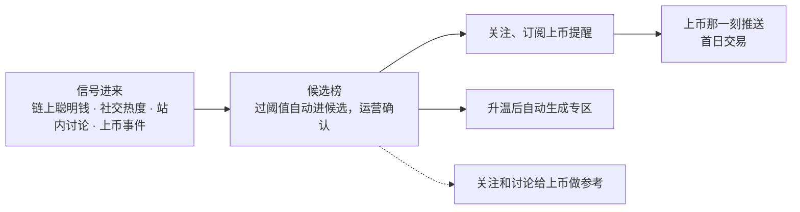

# 任务：用 lark-cli 原地改写已有的飞书文档《让用户为「早一步」来 MEXC》

文档已存在（链接我会给你，下面写作 `<id>`）。原地改写：URL 不变，内容按第四节整体替换。只用飞书文档自带的能力做视觉，不插任何图片。正文一个字不要改写、不扩写、不加你自己的解释。

## 一、先备份，再确认能整体重写

```bash
lark-cli docs +fetch --api-version v2 --doc <id> --detail with-ids \
  | jq -r '.data.document.content' | sed 's/></>\n</g' > /tmp/backup_$(date +%s).xml
grep -c '`），后续块 `--command append` 逐块追加，`&&` 串起来。每块 3–4 KB 以内，预计 12–14 块。
- `lark-cli`，docx 命令都带 `--api-version v2`；写操作前加 `LARK_CLI_NO_PROXY=1`；内容走 stdin；默认 DocxXML。
- `&` `<` `>` 写成 `&amp;` `&lt;` `&gt;`；标题编号写在文字里。
- 画板：上次 mermaid 画板生成成功，同样写法，`--doc-format markdown` 追加围栏，fetch 验证；失败就删掉换 3.3 的流程表。

## 三、版式规则（逐条执行）

1. `<h2>` 标题是一句结论，不带 emoji。
2. 每章开头是叙事段落（两到四段），不是要点；要点只用于列举并列事实，每章最多一组。
3. 每章一个主视觉（表或画板）；第 2、3、4 章允许第二张表。
4. 章末一个 callout，统一 `background-color="light-blue"`、emoji `📌`；摘要用 `light-yellow` `💡`；第 6 章用 `light-red` `⚠️`。
5. 表格统一 `<colgroup><col width>`，表头 `<th background-color="light-gray">`，表内不加粗，除非第四节标了 `**`。
6. 段落里不用 emoji；只有第 2 章条形图的 🟩 ⚪、第 3 章状态列的 🟢🔵🟡、第 7 章进度列的 🟩⬛ 可以用。
7. 内容只出现一次，后文引用前文用「见第 N 章」。
8. 不出现「老板」「Marvin」「差异化」「一句话：」「AI 生成」「追问」。

## 四、文档内容与顺序（逐字使用）

标题：`让用户为「早一步」来 MEXC：热点先上两周，广场让它先聊、先买`

### 摘要（callout 💡 light-yellow）

股票 Meme 专区正在随广场 1.5 上线。做它的过程中我们发现一件更大的事：近三个月的热点币，MEXC 合约比币安早上线两周以上，没有反例，但这段领先期里站内没有讨论阵地，用户看到热点的时间和别处一样晚。上币早这张牌只打了一半，供给早，注意力晚。

我们提议把专区做成一套追热点的能力，分三步：归类已有内容（1.5 在做）、上币即起话题（二期）、早发现（三期，核心）。三步由同一个专区承接，热点的来源一步比一步早，每一步都有交易按钮。背后是一条四层 23 个模块的管线，1.5 已建 9 个。

需要的支持集中在一处：对外采购链上数据和社媒情绪数据的评估与预算，它决定第三步什么时候能开始。

### 1. 市场的节奏变了，上币早只打了一半

一枚币从链上升温到爆发，往往只有几天到两周。信息慢一天，用户就从参与者变成接盘者。交易所都在做内容社区，币安 Square、OKX 社区、FOMO 都在争同一批用户和同一批 KOL，内容本身已经不构成竞争力。

MEXC 有一张别人没有的牌：上币早，现货和合约都早。第 2 章的数据会证明这一点。但上得早不等于用户最早看到、最早买到。领先期里站内没有讨论的地方，用户在推特、在链上工具、在别的社区形成判断，回到 MEXC 的时候往往已经是爆发之后。供给是早的，注意力是晚的，这就是我们看到的缺口。

股票 Meme 专区是在这个判断之前做的，它回应的是一个具体热点。做它的过程让我们看清：每一个热点都需要同样的三样东西，一个阵地、一群人在聊、讨论旁边就能买。这三样东西不该每次重做，而应该是广场的能力。

callout 📌 light-blue：缺口不在供给，在注意力。广场要做的，是把上币早这段领先变成用户看得到、买得到。

### 2. 近三个月热点币，MEXC 合约比币安早上两周以上，无反例

我们按同一口径核对了近三个月的热点币：MEXC 合约上线时间取自合约行情接口的 openingTime，币安和 OKX 的上线日取自各自上币公告标题。八枚币里七枚 MEXC 更早，一枚同日，平均领先两周以上。每 🟩 代表 5 天，向上取整；同日为 ⚪。

| 币 | MEXC 领先 | MEXC 合约上线 | 币安上线 |
|---|---|---|---|
| PONS | 🟩🟩🟩🟩🟩🟩🟩🟩🟩🟩🟩 53 天 | 2026-07-15 | 合约 2026-09-06 |
| MarsCoin | 🟩🟩🟩🟩🟩🟩🟩 33 天 | 2026-07-30 | 合约 09-01，现货 09-04 |
| UNITREE | 🟩🟩🟩🟩 19 天 | 2026-07-31 | 合约 08-19 |
| GRAM | 🟩🟩🟩🟩 17 天 | 2026-06-15 | 现货 07-02；OKX 现货 06-17 |
| 牛来 | 🟩🟩🟩 14 天 | 2026-08-16 | 合约 08-30，现货 09-09 |
| GRVT | 🟩 1 天 | 2026-07-30 | 合约 07-31；OKX 现货 07-30 |
| DOS | ⚪ 同日 | 2026-08-11 | 合约 08-11 |
| 哈基米 | 🟩🟩🟩🟩🟩🟩🟩🟩🟩🟩🟩🟩 11 个月 | 2025-10-11 | 合约 2026-09-06 |

这组数据说明两件事。第一，热点在 MEXC 先上是常态，不是个案。第二，领先期的长度足够做事：两周时间里，一个热点可以从候选变成专区，从专区变成首页置顶。

把竞争位置放到两条轴上看，看到得早不早、看到能不能直接买，只有一个位置能同时占住。推特和链上工具是信号源，最早，但看到之后要自己去找哪里买；币安 Square 和 OKX 社区能买，但上币晚，热点到它们那里已经是后期。MEXC 广场是交易所里最早，讨论旁边就是合约。

| | 看到得晚 | 看到得早 |
|---|---|---|
| 看到就能买（合约、账户里） | 币安 Square、OKX 社区：能买，但上币晚 | **MEXC 广场：交易所里最早，讨论旁边就是合约** |
| 看到了要自己去链上买 | | 推特、GMGN、Debot：最早，它们是信号源，看到之后要自己找哪里买 |

callout 📌 light-blue：对推特赢在看到就能买，对其他交易所赢在早。两条都从上币早推出来，不是口号。

### 3. 把专区做成一套追热点的能力，分三步，早发现是核心

专区不该只为股票 Meme 做一次。把它做成能力以后，每个热点一键成专区，每次上币当天就有话题，上币前就在广场。三步由同一个专区承接，热点的来源一步比一步早，每一步都有交易按钮。

三步的顺序是按风险排的：第一步只用站内已有的数据，第二步接的是我们自己的上币事件，第三步才接外部数据。前两步不依赖任何采购，第三步是核心，也是唯一需要外部投入的一步。

| 步 | 热点从哪来 | 广场做什么 | 用户能做什么 | 转化在哪 | 状态 |
|---|---|---|---|---|---|
| 一 归类已有内容 | 站内讨论、成交 | 帖子按标的、题材进专区，首页置顶，搜索页 Spotlight | 看、聊、买 | 专区到 K 线页 | 🟢 1.5 在做 |
| 二 上币即起话题 | 上币事件 | 官方账号起第一帖，正反方站队，AI 写介绍，persona 跟进 | 站队、讨论、买 | 上线首日交易 | 🔵 二期，接上币系统 |
| 三 早发现 | 链上聪明钱、社交热度 | 过阈值自动进候选榜，运营确认，升温后自动生成专区 | 关注、订阅上币提醒 | 上币那一刻推给关注的人，首日交易 | 🟡 三期，核心 |

#### 3.1 第一步，归类已有内容：股票 Meme 专区（1.5 在做）

专区是一组标的的页面，一段介绍讲这个题材为什么热、是什么，一条成员标的条带涨跌和交易按钮，下面是这组标的的帖子。专区由运营配置名字、封面、一句话、标的列表和生效时间，换热点不换代码。第一个专区是股票 Meme，成员是 PONS、MarsCoin 这类用美股代币做池子的 meme 币，以及被联动的 HIMS、HOOD、NVDA 等美股合约。

| 页面 | 作用 |
|---|---|
| 首页置顶帖 | 第一屏一张专区帖，参考 FOMO 的首页置顶，点进专区 |
| 专区页 | 介绍、成员标的条、帖子，讨论和交易在一页 |
| 搜索页 | Spotlight 放多个专区；Crypto 和 Stock 标的列表，点标的进标的页 |
| 标的页 | 一个标的的全部帖子，页头有行情和交易按钮 |
| 合约 K 线页 Square 页签 | 看盘时能看到这个币在聊什么 |

用户路径是首页置顶帖到专区页，再到成员标的，最后到 K 线页开仓。内容由 AI persona 按标的持续产出，AI 审核把关。

#### 3.2 第二步，上币即起话题：每个新币上线当天就有讨论（二期）

新币上线当天，官方账号自动发起话题帖，讲这个币是什么、为什么上，正方和反方各一句；用户站队、讨论，话题帖直接带交易按钮；persona 跟进，AI 写介绍，讨论升温后生成专区。面向所有新币，不只股票 Meme。上币公告的流量直接导进话题，公告第一次有了讨论的落点。正反方站队是冷启动的解法：官方发第一帖，用户只需表态，一次点击就是一次参与。

#### 3.3 第三步，早发现：站外在热、站内还没上的币，先在广场出现（三期，核心）

早发现把「交易所里最早」从上币团队的能力，变成用户能看到的产品。它的输入是站外信号，输出是候选榜、关注提醒和自动生成的专区，承接是上币那一刻的推送和首日交易。

画板（mermaid，追加后 fetch 验证；生成不了就用下面的流程表代替）：



流程表（画板生成失败时使用）：

| 信号进来 | → | 候选榜 | → | 关注、提醒 | → | 承接 |
|---|---|---|---|---|---|---|
| 链上聪明钱为主，社交热度、站内讨论为辅，上币事件硬触发 | | 过阈值自动进候选，运营一键确认；带链上数据、讨论数、发现时间 | | 关注候选币，升温推送，订阅上币提醒 | | 上币那一刻推给关注的人，首日交易；升温后自动生成专区；关注和讨论给上币做参考 |

信号怎么取、怎么加权，是这一步的关键设计。社交声量容易有水分，所以只做验证，不单独触发；链上资金流是主信号；上币事件是硬触发。

| 信号 | 来源 | 权重 |
|---|---|---|
| 链上聪明钱 | 资金净流入、持币地址增速 | 主信号 |
| 社交热度 | 提及量、增速 | 辅助，用来验证，不单独触发 |
| 站内讨论 | cashtag 帖子、人在聊、关注数 | 辅助 |
| 上币事件 | 上线、盘前 | 硬触发 |

候选榜的规则是：链上热度过阈值的币自动进入候选，运营一键确认后对用户露出；阈值用相对值，上线后按数据校准；每个候选带链上数据、站内讨论数、发现时间，面向所有热点和新币。每个热点按数据状态分萌芽、升温、爆发、退潮四段，萌芽是候选榜，升温是专区，爆发是首页置顶，退潮是归档；阶段是数据状态，不是投资建议。

候选榜的关注数和讨论量是站内需求信号，可以给上币团队做参考。这条通路目前没有，需要和现货团队对一次他们看什么、需要什么，再定信号怎么给。

callout 📌 light-blue：站外的信号、站内的承接。热点在它上 MEXC 之前就先在广场出现，用户关注、订阅提醒，上币那一刻推送、首日交易。

### 4. 背后是一套四层 23 个模块的系统，以后再来一个 PONS 它这样走

这不是加一个页面，是一条从站外到下单的管线：信号进来，AI 处理成专区和话题，产品承接，交易闭环。四层里 AI 热点引擎是中枢，它把信号变成对象：认出帖子在说哪个币，把帖子归进专区，上币时起话题，按阶段自动生成候选和专区。运营从「找热点」变成「审热点」，只做确认、升降阶段和改封面，介绍由 AI 起草。

| 层 | 这一层做什么 | 模块 | 分期 |
|---|---|---|---|
| 信号层 | 每个币一条时间线 | 行情与成交；站内内容；上币事件；链上聪明钱、社交热度（第三方数据，需采购） | 🟢 2 · 🔵 1 · 🟡 1 |
| AI 热点引擎 | 把信号变成专区和话题 | 认币、关联；归类、写介绍；起话题；阶段机、自动生成；AI 审核、运营工作台 | 🟢 2 · 🔵 2 · 🟡 1 |
| 产品层 | 用户看到的 | 首页置顶、专区页；搜索页、标的页、K 线页签；官方话题帖；热点榜、候选榜、提醒 | 🟢 2 · 🔵 1 · 🟡 1 |
| 交易承接 | 每一步的终点 | 开仓、下单；上币推送、首日交易；归因、给上币参考 | 🟢 1 · 🔵 1 · 🟡 1 |

以后再来一个 PONS，它在这套系统里这样走：

1. 链上资金先动，候选榜把它挂出来；7 月 15 日上 MEXC 合约，比币安早 53 天。
2. 帖子里没写 cashtag 也认出在说它，上币当天自动生成话题，讨论升温后自动成专区。
3. 官方账号起第一帖，正反方站队；爆发时首页置顶它的专区，讨论旁边就是合约。
4. 关注它的人上币那一刻收到推送，首日就在站内下单；关注和讨论给上币团队做参考。

🟢 1.5 在做 9 个，🔵 二期 7 个，🟡 三期 7 个。

callout 📌 light-blue：用户看到的是上面那条故事线，研发建的是下面那排模块；1.5 已经建了其中 9 个。

### 5. 带来什么：用户早看到，上币有承接，公司的领先变成交易量

这套能力对应广场的三个目标，流量阵地、讨论氛围、站内转化，三步各接一段。对用户，它是来 MEXC 的理由：热点在这里先聊、先买。对上币团队，它是每次上币的承接：上线当天就有人聊、有人买，候选榜的关注和讨论还能作参考。对公司，它把上币早这张牌用满，美股 Meme 这类题材随时能接，领先期变成交易量。

| 给谁 | 价值 | 怎么体现 |
|---|---|---|
| 用户 | 热点在 MEXC 先聊、先买 | 候选榜、上币提醒、专区里的交易按钮 |
| 上币团队 | 每次上币都有人聊、有人买；候选榜的关注和讨论作为参考 | 上币即起话题；需求信号 |
| 公司 | 美股 Meme 这类题材随时能接；上币早这张牌被用满，领先期变成交易量 | 新币首日有讨论、有交易 |

我们会按三步分别观察，口径是观察口径，不是承诺：第一步看专区曝光到下单的转化和 10 分钟归因交易额；第二步看新币上线首日的讨论量和归因交易额；第三步看候选币的关注数和上币后关注者首日交易占比。

callout 📌 light-blue：价值的衡量不靠命中率，靠每一步是否有人聊、有人买。

### 6. 风险与边界

这套能力的边界先定清楚，才能放心做大。它只聚合和展示数据与讨论，不做决策指引，不给任何个人背书；阶段和候选都是数据状态；上币的决策权在上币团队，广场只提供参考。

| 风险 | 做法 |
|---|---|
| 候选不一定命中 | 不承诺命中，只展示数据；价值在于用户在这里最早看到，命中几次就够 |
| 用户少，聊不起来 | persona 按标的保供，官方账号起第一帖，上币公告的流量导进话题 |
| 社交信号有水分 | 社交热度只做辅助验证，链上资金流为主 |
| 合规 | 不做决策指引，不给个人背书，阶段和候选都是数据状态；法务口径提前对 |
| 外部数据的成本 | 第三方采购，和热点资讯线统一，口径和成本待评估；评估未通过则先做前两步 |
| 和上币团队的关系 | 先对需求再定接口，广场只提供参考，上币决策不变 |

callout ⚠️ light-red：前两步不依赖任何外部数据和外部团队，三期的边界由采购评估和现货团队的需求决定。

### 7. 节奏与需要的支持

| 阶段 | 进度 | 时间 | 做什么 | 协作方 | 需要 |
|---|---|---|---|---|---|
| 一期 · 1.5 | 🟩🟩⬛⬛ | 进行中 | 专区、首页置顶、搜索页、K 线页 Square 页签 | 设计、研发 | 无 |
| 二期 | ⬛⬛⬛⬛ | 1.5 上线后 | 上币即起话题、关注与上币提醒、热点榜 | 现货团队（上币事件）、研发 | 接上币系统 |
| 三期 | ⬛⬛⬛⬛ | 二期后 | 候选榜、早发现、AI 认币和关联 | 热点资讯线（数据）、现货团队（接口）、用研 | 第三方链上和社交数据采购；和现货团队对接口；一轮用研，链上交易者做决策看什么 |

需要支持的地方集中在一处：对外采购链上数据和社媒情绪数据的评估与预算。它不影响前两步，但决定第三步什么时候能开始。我们会先和热点资讯线统一口径、做一轮采购评估，评估结果再单独汇报。

callout 📌 light-blue：一期在做，二期接上币系统，三期接站外数据；每一期都有可交易的承接，三期的开始取决于数据采购的评估。

### 8. 希望得到认可的事

方向和三步路径。数据采购的口径和成本、和现货团队的接口，认可后再分别推进。

### 附录 A · 术语

| 词 | 意思 |
|---|---|
| 专区 | 一组标的的页面：介绍、成员标的条（带交易按钮）、这组标的的帖子 |
| 标的页 | 一个标的的全部帖子，页头有行情和交易按钮 |
| 候选榜 | 站外在热、站内还没上的币的榜单，按链上热度排 |
| 早发现 | 第三步的能力：候选榜加关注提醒加自动生成专区 |
| 热点榜 | 站内已上线标的按热度排的榜，二期 |
| 上币即起话题 | 新币上线当天官方账号发起的话题帖，正反方站队 |
| persona | 广场的 AI 内容账号，按标的持续产出讨论，经 AI 审核 |
| 阶段 | 萌芽、升温、爆发、退潮，按数据状态划分，不是投资建议 |

### 附录 B · 数据口径

- MEXC 合约上线时间：合约行情接口 openingTime，UTC。
- 币安上线时间：币安「新币上线」公告标题所示上线日；合约与现货分别记录。
- OKX 上线时间：OKX「新币上线」公告发布日。
- 领先天数：币安最早上线日减 MEXC 合约上线日。
- 同口径每月复核一次，新热点币补入。

## 五、改完后的校验（必须做，结果贴回来）

```bash
lark-cli docs +fetch --api-version v2 --doc <id> --detail with-ids \
  | jq -r '.data.document.content' | sed 's/></>\n</g' > /tmp/dump.xml
grep -c '<h2' /tmp/dump.xml        # 应为 10
grep -c '<h3' /tmp/dump.xml        # 应为 3
grep -c '<callout' /tmp/dump.xml   # 应为 8
grep -c 'light-blue' /tmp/dump.xml # 应为 6
grep -c '<table' /tmp/dump.xml     # 画板成功时 10，用流程表时 11
grep -c '<img ' /tmp/dump.xml      # 应为 0
grep -ci '老板\|Marvin\|差异化\|一句话：\|追问\|AI 生成\|generated by' /tmp/dump.xml   # 应为 0
grep -c '🟩🟩⬛⬛' /tmp/dump.xml    # 应为 1
```

另外贴回：画板有没有生成成功；哪些 DocxXML 属性不支持、你用了什么代替。
