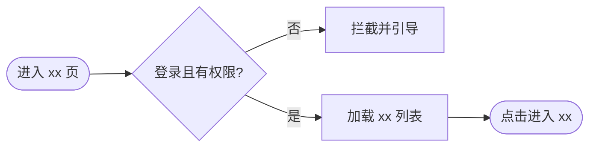

<!-- PRD Authoring Kit · © Noah Zhan (@noah.zhan) · 二次分发/衍生须保留署名，不得标榜为自己原创创作。LICENSE / NOTICE 见根目录。 -->
# PRD 模板 · house-style + nocode 严谨度

> **使用方式**
> - `> 【指引…】` 行是写作提示，**发布前删除**（`06-lark-publish.md` 步骤0 会剥离 `> 【指引` 开头的行；顶部说明块、`PRD Quality Gates` 节、`（填写：…）` 占位符需一并清掉，06 有净化脚本兜底）。
> - 标 **[nocode必填]** 的小节是本团队 PRD 惯常遗漏、但会被 nocode 门禁扣分的地方，别删。
> - 数字/涨跌/百分比字段的显示口径、UI 词条「」约定（**禁反引号 / code 样式包裹**，见 `07 §二`）、措辞排版禁忌 → 统一见 `references/07-format-conventions.md`，不在此重复；表格/画板/加粗/颜色的**选型与节制**见 `07 §五之二`。
> - **对齐颗粒度看范例（先看简洁的）**：**优先 `references/examples/example-real-draft-concise.md`（house 真实粒度，大多数需求应接近它的简洁度——需求逻辑每端几条 bullet、兜底一句）**；`example-mini-lightweight.md`（轻量档）；`example-copytrading-PASS.md` 是**复杂功能的上限**，别把简单需求写成那样（该范例的「后端逻辑」已按 `07 §二之三` 对齐——两列 `信息 | 说明` 的**接口信息需求清单** + 「触发情形 → 用户看到的文案与动作」+ 行为级幂等，**形态可直接照抄**，只是颗粒度别照搬）。门禁必需章节在简洁基础上**最小增补**即可（见 `01 §0.5`）。范例给你看的是"该有多瘦的粒度"（需求逻辑每端几条 bullet 的简洁度），但结构仍按本模板的元素表骨架（格内**按该元素实际有的规则类型分组、组名自拟**——展示条件/展示规则/交互只是常见起手，不是固定三类，见 `07 §五.2`；纯后端/纯埋点/系统管道类需求走下方三条各自写法；**B 端管理后台需求不豁免元素表骨架，是在其上另加下方「四件套」清单**）——别因范例是纯 bullet 就省掉元素表。
> - **纯后端/服务/调度类需求**：仍用本模板的 **US-R 三件套骨架**（需求逻辑/后端逻辑/异常与兜底；验收在文末独立章节），只把「需求逻辑」写成系统行为、跳过「线框原型图 / UED设计稿」；**后端逻辑的接口信息需求清单（业务中文列"要哪些信息"，含数据来源指针）与幂等约束照写不误**（范例的 US1-R4/R5 就是纯后端段落且已 PASS）。`references/templates/ref-counterpart-backend.md` 仅作行文措辞参考，**不要整套换骨架**。
> - 🔴 **`templates/` 与 `examples/` 只供「措辞与颗粒度」参考，章节结构以本文件为唯一权威**：`templates/ref-counterpart-backend.md` / `ref-counterpart-frontend.md` 是**对接人视角的沟通参考**——它们顶部的「文档信息」（作者 / 状态 / 需求类型 / 关联 Ticket / 评审人）、「变更记录」、「一、背景与目标」这套编号骨架**不是 PRD 骨架，一个都别搬进 PRD**（PRD 只有本文件的 `编写记录` 表 + 具名双语章节）。**实测**：一份实战 PRD 自造了「文档信息」章，逐字来自那两份参考模板（会话读了 2 次、全程没意识到它不是骨架）——所以这条不是提醒，是准入：**落笔前先问一句"这个章名在 `02` 里有吗？"没有就不写。**
> - 🔴 **别自建技术方案章节——判据看内容，不看章节名**：**凡集中汇总多个接口/服务的提供方、消费方、错误码、失败动作的章节，无论叫什么名字都不建**（实测出现过的名字：「接口模块与字段契约」「服务能力与业务信息需求」「系统数据流 / 服务架构」「研发启动与联调清单」——**换个名字还是它**：实测一次升级把黑名单章改名为「服务能力与业务信息需求」，内容仍是 50 行集中式接口章，靠按名字判的黑名单没拦住）。研发原话锚：一份后台 PRD 因此被吐槽"你这个写的是产品需求文档还是技术方案啊"。依赖只在**「需求关联方与依赖」表**和元素表**「后端说明」列**占位；**要给研发提信息需求，就在该 US-R 的「后端逻辑」小节列「接口信息需求清单」小表**（业务中文列"前端要哪些信息"，如：快讯正文/来源/发布时间/原文链接；**一条信息一行、别顿号挤一格**；不写字段名、类型、必传约束——见 `07 §二之三` ✅ 第二档）。🔴 **信息需求清单只能分散**在各 US-R 的「后端逻辑」小节里，**集中成一章 = 与各 US-R 双真源，必漂移**。颗粒度见 `01 §0.5` 依赖接口条、行为/机制边界见 `07 §二之三`。
>   - **点名豁免（这四张汇总表不是接口信息汇总，别误杀）**：**配置项总表**（运营照它调参，`07 §二之三` 保护清单第 4 条）、**通用业务口径块**（复述上限指定的唯一定义处，见下方「复述上限」）、**Data Requirements 埋点表**（`09` house 骨架）、**错误码表**（码 ↔ 用户文案的映射，QA 照它验、i18n 照它翻，`07 §二之三` ✅ 错误码表条）——它们汇总的是**运营/QA/i18n 可感知的口径**，不是接口的提供方/消费方/失败动作。判别式：这张表变了，**运营改不改操作、QA 改不改验收**？改 → 可感知口径，留；只影响研发怎么联调 → 集中式接口章，拆散或删。
>   - **升级已有 PRD 撞见时**：向产品建议**拆散回各 US-R 的「后端逻辑」小节**，或删除；**不静默保留，也不接受换个名字保留**。

> **记号图例**（发布前处理见 06 步骤0）
> | 记号 | 含义 | 发布前 |
> |------|------|--------|
> | `> 【指引…】` | 写作提示 | 删除 |
> | `（填写：…）` | 占位符，替换为真实内容 | 替换完 |
> | `[nocode必填]` | 门禁重点，别删该节 | 保留内容、删标记 |
> | `PRD Quality Gates` 节 | 定稿前自检清单 | 整节删除 |

> **轻量路径（小需求用，避免为小事填满全表）**
> 判定：**1 个 US-R 且不新增/改动 发奖·行情取数·主动推送链路**（涉资金但纯入口/文案/展示位、不碰发奖逻辑亦可）→ 走轻量档。
> - 可折叠：目标用户+成功指标合并成一两句；**背景/价值各 ≤1 句**（仍须答「谁+什么问题」，不许空喊）、**禁修饰性从句**（「难以转化为交易意愿」「把首屏流量引向 XX」这类营销化发挥不写——背景是事实陈述，不是软文；两段还禁互相复读同一句痛点）；「本期不包含」至少列 1 条真实排除项（别只写空洞兜底句）；异常写 失败+空+断网（有数据链路时；纯静态展示元素按下方「异常表行准入」指引，只写确有决策的资源类异常）。
> - **不可省的硬地板**：需求逻辑（分支唯一可推导）+ 验收标准；涉资金则幂等段落仍须完整（缺失照 P0）。纯后端小需求：成功指标写"判定口径一句话"，mermaid 可省，埋点写"本需求无需埋点"。
> - **体量预算（轻量档）**：正文目标 **≤100 行**（编写记录/章节骨架标题不计）。超预算**不是加解释的理由，是先跑「复述上限」机械自查再交付的信号**——简单需求写到 150+ 行，多半是复读或臆造，回头砍，别直接发。
> - 轻量门禁：`P0=0` + 成功指标有判定口径 + 每 US-R 有验收（其余 P1 不阻塞轻量档）；`score` 仅参考、不作门槛。**禁止为凑分编造指标/验收**——写不出真指标就写可判定口径，不要编数字。
> - **复述上限（所有档通用，交付前按此机械自查、别靠语感）**：同一条 事实/保证/口径 全文**至多两处**——定义处（通用口径块或元素表）＋验收断言；第三处起一律删除或写「见通用口径」。**「定义处」是位置概念、不是要写进正文的标注**：禁止给它加「（本文档唯一定义处）」这类纪律标记（见 `01 §0.5` 交付物纯净度③）。**通用口径块已写的句子，元素表行内/异常表/NFR 禁止再次出现**（`07 §五` "行内只写差异项"是硬约束不是建议——到处贴保证不是防御式写作，关键处一次写清才是）。异常表只写元素表未覆盖的场景；NFR/风险/【待确认】无真实新增信息则整节省略。
>   - **受管短语两族（同上限，别只盯"保证句"）**：① **保证句**——"不响应点击 / 不依赖列表数据 / 无需发版 / 不区分登录态"这类；② **需求性质定性句**——"前端（代码）写死 / 纯静态展示 / 不可点击 / 无后端改动 / 不读取接口（配置）"这类。**两族同权、全文同样 ≤2 处**（定义处＝通用显示口径或归属声明，＋验收断言 1 处）。实测教训：定性句因为"看着像在交代需求性质、不像保证"而整族逃过自查，一篇 150 行的轻量档里「前端写死」×3、「不可点击」×4、「无后端」×3。
>   - **机械自查法（交付前必跑）**：通读一遍你自己的稿，把出现 ≥2 次的 保证/定性/口径 短语列成 top 清单（通常 3-5 个），逐个全文计数——**任一 ≥3 处即超标**，收敛到「定义 1 处+验收 1 处」再交付；别只 grep 本条列举的例句，例句只是形态示意。（`05` 步骤4 前置与步骤5 报告各有一行强制勾选，别指望自觉。）
>   - **规则级同款（短语数完再数规则；2026-09 补——模型会换措辞绕开短语计数）**：抽 3 条分支规则（降级 / 兜底 / 优先级各一），全文数落点（元素表 / 分支小表 / 异常表 / 验收 / 流程或实验说明 / 背景），**同义改写也算一处**；只许「定义处 1 + 验收 1」，第 3 处起删（机械勾选项见 `05 步骤 0 ⑩`）。
>   - **模板具名槽位不入复述计数**（元素表「后端说明」列、Data Requirements 情况B 这类表格固有格——每行一个具名格，不是散文复读）；但纯前端元素的「后端说明」列**直接写「/」**，别逐行写「无后端字段，前端静态写死」——指针交给「后端逻辑」的一句归属声明（实测：两张元素表各复读一遍，把全文「写死」推到 4 处）。
>   - **凑数句负例（整行删）**：「兼容线上最低系统版本」「渲染耗时不明显增加」这类放之四海皆准或不可测的句子。
>   - **豁免 = 沉默**：命中豁免的主题（如纯展示需求的幂等、无埋点需求的埋点字段）**连豁免声明都不写**——❌「本需求为纯展示，幂等沿用现状」整句是废话；豁免的意义就是这一句都省掉。（需要留痕的用 Data Requirements 情况B 这类模板既有具名槽位，槽位一句即收，不另加散文。）
>   - **封闭词不双写**：「仅 / 只 / 常驻」已经把面封闭了，**不再补一句反面**——❌「仅挂载在「股票」tab」+「其余一级 tab 不展示」双写；✅ 一句「仅挂载在「股票」tab」完事。反面句**只在反面行为特殊时才写**（其余 tab 要显示别的东西、或要显式做点什么）；单纯"其余不展示"是「仅」的同义反复，属复述超标同族。
>   - **归属声明 ≤1 句，禁列举式否定**：❌「不新增不修改任何接口与字段／不读取任何行情或配置数据／不改动计算扣费发放链路」连排——把无关系统逐个点名 = 新增可挑面；✅ 一句「无后端改动，标签为前端静态资源，数据链路沿用现状」收口完事（硬上限判据见 `01 §0.5` 归属声明条）。

> **纯埋点/纯数据需求薄路径（需求主体=只新增/修改埋点，用户可感知体验零变化；实测教训：机械展开全模板≈四成水分）**
> 判定命中 → 按轻量档，再加五条裁剪（骨架沿用上面「纯后端」写法：跳过线框/UED、需求逻辑写成系统行为、不硬造单行元素表；**五条裁剪与轻量路径条目冲突时以裁剪为准**）：
> 1. **Data Requirements 是主体、字段唯一真源**：字段/枚举/必传/取值**只在埋点表定义一遍**；US-R 的「后端逻辑」一句归属声明收口（如"无业务后端改动，新增事件经现有埋点 SDK 通道上报——该通道对任意新增事件/属性均生效，无本需求特有处理"，带覆盖确认从句才过 `05` 归属声明硬闸），**禁止再列一张字段表**——「字段表」特指重复列 字段名/类型/必传/来源 的后端字段表；需求逻辑的判定/口径表以枚举值为行键引用取值，**不算二次定义**。
> 2. **需求逻辑 = 口径定义，这部分不许薄**：触发时机的唯一判定、枚举取值的判定规则（每值一行）、计时/计数口径（起点/终点/暂停恢复/单位取整/异常缺省）——这些小表是这类需求的"需求逻辑"本体，不写则双端实现必不一致、数据白埋。
> 3. **省掉**：线框/UED 小节（正文一句"沿用现有 UI，无变更"即可，不设小节）、mermaid、独立「风险」表（真风险并入 异常与兜底）；Localisation / NFR 内容为"无"时各一行带过，不成节。异常与兜底**只写埋点特有场景**（多因竞态/重复回调/计时起点丢失/前后台切换），SDK 传输失败一句"沿用现有 SDK 缓存与重试（对新增事件同样生效）"收口——示例句自带覆盖确认从句，照写即可过 `05` 归属声明硬闸。
> 4. **验收忠于口径、不逐字复读**：按「枚举每类一条 + 计时特例（前后台/遮挡/即时消失/竞态）」写**可操作的验证动作**，判定规则引用需求逻辑的口径表，别把口径整句抄进验收再来一遍。
> 5. **门禁骨架保留**：`05` 结构扫描器认的**七个具名章节全留**——背景/目标用户/成功指标/本期不含/功能需求/验收标准/数据与埋点（**埋点本身不升档**——2026-07 起埋点是常规需求、可判 simple，档位只看 `00` 判体量区的估算依据表与资金·交易·推送护栏）。目标用户可压成一句话，**但保留具名小节标题**（扫描器按标题定位）——**薄的是节内内容，不是砍章节**。

> **系统/管道/AI-agent 类需求骨架（需求主体=多系统协作的自动化管道或 AI 能力——内容生成/审核/打分/调度/机器人应答等，UI 只是出口（出口若是管理界面，界面部分仍须按下方「B 端管理后台」路径写全，不因主体是管道就略写界面）；方向与上两条相反：不是裁剪，是加"模型层"）**
> 判定命中 → 元素表骨架不适用（**本条是 02 认可的例外：元素表骨架不适配管道类需求**，与上方「纯后端不要整套换骨架」并行不悖——那条管的是有明确 US-R 载体的后端需求），改用四层骨架，**自上而下写、规则只能挂在已定义的模型上**：
> 1. **概念表先行（第一节就给）**：核心实体逐行定义——`实体 | 一句话定义 | 生命周期状态 | 谁持有/存储 | 进出规则`。**任何非通用名词（选题/事件/队列/XX模型…）首次使用前必须已在概念表或对接表出现**；"先用后定义/永不定义"按结构缺口处理（读者第一次撞见没定义的词，理解就断了——实测用户原话"突然冒出一个生命周期，让人无法理解"）。
> 2. **有状态实体过"生命周期五问"**：有哪些状态？怎么进入？怎么退出/过期？停留在哪（谁持有的什么队列/池）？**空了/满了时系统行为是什么**（含与兜底链路的衔接）？——触发条件/冷却/配额这些**规则**，写之前先自问"这条规则约束的对象在概念表里吗、它的队列定义了吗"；挂在未定义实体上的规则=悬空规则，必被追问（实测：写了冷却与配额，被问"每个 persona 的消费队列怎么维护、空了怎么衔接节奏驱动"——整层模型缺失）。
> 3. **每步流程带执行主体**：跨系统流程的每一步以执行方开头（本系统/X 侧/运营），**执行方必须在「需求关联方与依赖」表内**；他方系统只写"我们消费什么（格式/字段/时机）"，**不写其内部实现**（越界写别人的实现=错误的职责边界，实测"打标"归属写反被用户纠正）。
> 4. **配置项集中表（文末必附）**：全文每个"可配/后台可配"必须在文末「配置项表」落一行——`配置名 | 作用对象 | 默认值 | 可调范围 | 生效方式`；**裸"可配"不落表=把决策踢给未来，按缺口处理**。默认值给依据（业务节奏/竞品/实测），拍不准就在表内标「初值，评审定」。**配置项节制（实测：23 行配置表被产品判"过多"）："可配"有真实成本（后台开发+运营心智），默认写死**——纯技术参数（调度周期/过期时长/重试/延迟区间）一律写死；只有产品明确要运营调节奏的参数（配额/时段/冷却/上限这类）才设可配。拍不准就问产品「这个值你们要经常调吗？」。
> 5. **链路配画板（可读性硬要求，实测大段编号文字是这类 PRD 头号劝退点）**：跨系统链路、≥4 步的流转/消费/生成管线、多分支判定，各配一张**原生画板导览图**（mermaid fence 写、导入自动转）；图给 10 秒看懂全貌，文字给逐步判定规则（文字是唯一权威口径）。**禁止画板旁再贴 mermaid 源码**。
> 6. **规则句悬空引用自查（写完每条规则立刻做）**：句中引用的 **具名机制**（XX 门槛/XX 筛选/XX 校验）、**映射表**（XX 词表/XX 映射）、**时间窗**（XX 时段/XX 周期/XX 窗口）、**集合**（XX 池/XX 队列/候选集）——逐个回查：判定规则/结构样例/边界定义，当句或全文**有定义可跳转吗**？没有就是悬空引用，当场补或问产品。三条细则：①具名机制优先问产品「**复用现有流程还是新建标准？**」（实测：「推文质量门槛」悬空，产品反问"要不直接用质量打分的流程?"——写作时一句话就能问掉）；②映射表必须给 **1-2 行结构样例**（如 标签「公链」→ [SOLUSDT, AVAXUSDT…]，标注「样例，以 XX 词表为准」+维护方）；③自造时间窗（「同一活跃时段」这类）必须给边界口径（起止/跨窗归属/滚动还是自然切，见 `07 §一` 分段口径）。

> **B 端管理后台类需求路径（需求主体=运营/管理后台的界面型功能——列表/筛选/表单/弹窗/详情/队列处置页；实测：混合需求里逻辑层写成范本、界面层系统性漏项）**
> 判定命中 → 界面部分按本路径写；**可与「系统/管道骨架」并存**（混合需求常态：管道状态层走概念表/生命周期，每个页面/Tab 的界面层走本路径，两层都要写全）。核心=**页面解剖机械清单**（B 端页面形态高度固定，防漏靠清单不靠模型自觉）：
> 1. **列表页四件套（每个列表页逐项过，写不出=当场问产品）**：①**筛选与搜索**——逐控件：控件类型（下拉/多选/日期区间）/选项枚举/默认值，搜索（覆盖字段/placeholder），有无重置及重置行为；②**列表**——逐列：字段/显示格式（长文本截断规则·缺失兜底·是否悬停展全）/可否排序，默认排序，分页（每页条数/是否显示总数）；③**操作列**——逐按钮：显示条件/点击行为/需否确认及确认文案；④**详情**——入口方式（点行/按钮/抽屉/弹窗）+展示字段逐项列（禁「详情展示作者、正文、状态等」一句话塌缩——实测漏项重灾区）。
> 2. **表单/弹窗件套**：逐字段：控件类型/必填/校验规则与提示/默认值/上限；提交行为：提交中状态/成功后（关窗？刷新？toast？）/失败（保留输入？）。
> 3. **载体**：元素表（照本模板 原型/元素/说明/后端说明 四列，别减列）或按区域分小节皆可，但**四件套每项必须有着落**；原型截图（B 端常为 HTML 稿）贴「原型」位，**截图不豁免文字清单**——审查器读不到图，逐项文字仍是唯一权威。
> 4. **不写的仍不写**：组件视觉样式（颜色/圆角/间距/具体像素）——用 house 后台组件库默认，见 `07 §二之二`。

---

# 【需求方向】xxx PRD

## 编写记录

| # | Version | Description 变更摘要 | Author | Commented | Confirmed | Date |
|---|---------|--------------------|--------|-----------|-----------|------|
| 1 | v1.0 | 初稿 | （填写：@作者） | N | N | （填写：YYYY-MM-DD） |

> 【指引｜编写记录（实测被产品点名）】**顺序：自上而下版本递增**——v1.0 在第一行，新版本**追加到表尾**，别把新版插到最上面。**Author 列 = 本次实际执笔/操作的人的 lark 名**（如 `@noah.zhan`；AI 代跑就写发起人的 lark 名），❌ 别写「产品」「AI」「研发」这类角色词。Description 一句话讲清**本次改了什么**，不写改动理由与过程。
> 🔴 **Author 写成 @提及富文本**（飞书人名卡片，XML 里是 `<cite type="user" user-id="ou_xxx" user-name="XX"></cite>`，用 `lark-cli contact` 按姓名解析 open_id，命令以 `lark-cli skills read lark-contact` 为准；markdown 路径表达不了 @，先建文字版再用 `06 步骤3` block 级补），**不是纯文本名字**（实测产品点名："要这样，而不是简单把名字放上"）。
> 🔴 **落地时机说死（v1.4.32 规则，实测又漏）**：走 **markdown 直发 docx** 的默认路径时（`06 步骤1`），@ 提及**表达不出来、必然先落成纯文本人名**——所以 **发布成功后必须紧接着按 `06 步骤3` 做一次 block 级补 cite**，把 Author 格里的纯文本名字换成人名卡片，**这一步是发布动作的一部分、不是可选打磨**。🔴 **轻量档不豁免**：轻量档裁的是内容篇幅，不是这条（实测：一份轻量档 PRD 的 Author 停在纯文本人名上，被产品当场点名）。发布后自查一句：**编写记录 Author 格现在是卡片还是纯文字？** 是纯文字就回 `06 步骤3` 补。

> 读者路由：研发→模块地图+功能需求；QA→验收标准；运营→配置项总表

> 【指引｜读者路由】编写记录表之后**放这一行，就一行，不展开**——给三类读者各指一个入口，省掉"这么长我该看哪"。**只提本篇真有的章节**（没有配置项总表就删掉"运营"那截，别指向不存在的章节；没有模块地图的轻量档整行可省）。行内的 `→` 是**路由指向**、不是逻辑串接，不违反 `07 §三`「禁 `→` 串逻辑」——那条禁的是拿箭头替代判定步骤。

---

## Background & Business Values 背景与价值

| 字段 | 内容 |
|------|------|
| 背景 | （填写：**谁**在**什么场景**遇到**什么问题**，影响多大。讲清痛点，别只写"提升体验"） |
| 价值 | （填写：本次用**什么手段**帮**谁**解决**什么**，带来什么可观察/可归因收益） |
| BRD文档 | （填写：链接或"无"） |
| 需求来源 | （填写：@提出人） |
| 需求Jira单 | （填写：https://jira.mxcb.xyz/browse/APP-xxxxx，多个并列） |

> 【指引】背景要能回答"谁/什么问题/影响多大"，否则被判"停留在口号"。背景/价值多于 1 条时逐条 `1.` 编号且条间 `<br>` 换行，禁止贴排成一段文字墙。
> 【指引｜需求Jira单】**卡已建 → 填卡号链接**（`https://jira.mxcb.xyz/browse/APP-xxxxx`，多个并列）；**还没建 → 填占位「待建卡」，建卡后回填**（别空着，也别为了填它去催建卡——写 PRD 与建卡不分先后）。

### 目标用户 **[nocode必填]**

| 用户角色 | 关键特征 / 使用场景 | 规模 / 优先级 |
|---------|--------------------|--------------|
| （填写：如"有跟单意向、看不懂盘的合约用户"） | （填写：角色特征 + 在什么页面什么心智下用） | 主要 |

> 【指引｜target_user_clarity(P1)】禁止只写"所有用户/相关人员"。至少 1 个有区分度的主要角色 + 场景。（轻量档可与成功指标并成一句）

### 成功指标 **[nocode必填]**

| 指标 | 目标 | 统计口径（分母/周期） |
|------|------|--------------------|
| （填写：**1 个最直接相关**指标，如"首页合约榜曝光率"/"XX 点击率"） | （填写：一个简单具体目标，如 `+5%`，**低目标 OK**） | （填写：如"7 日，分母=XX 曝光/点击数"） |

> 【指引｜success_metric_quantification(P1)】**只需 1 个最直接相关指标 + 一个具体目标 + 分母/周期**（曝光率/点击率之类；`+5%` 这种低目标完全够）。目标值**由产品在对话中拍板**；拍不了就在口径/备注里标「初值，上线后由数分校准」（诚实且门禁安全）。**默认不加护栏、不堆多个指标、不写"待运营回填/待确认"**；仅涉资金/客诉风险的需求可选加 1 条护栏（口径以 `01 §3` 为准）。
> 【指引｜实验类需求（AB / 多因子 / 灰度对照）的成功指标】**本章只放 1 行决策指标**，形态：`指标 | 判定规则一句 | 口径`——判定规则写成结论式（"跳转组有效点击率相对展开组无显著下降即全量；两档时长无显著差异取 6s"），显著性一句「沿用 AB 平台标准」收口。**不进本章的**：分组表（`组 | 因子取值 | 流量`，那是需求逻辑里的一张小表）；交互效应检验、主效应合并、样本量、分析顺序（那是数分的实验分析方案，研发和 QA 不按它干活）；"不作为独立决策指标"的说明句（没打算用的指标一个字不写）。**决策规则全文只写这一次**——需求逻辑的实验小节写「分组 + 每组行为 + 回退」，结论处一句「按成功指标判定」引用，验收同样引用不复述。判据：读者是研发和 QA，他们要的是分几组、每组什么行为、回退到哪；**怎么分析数据不是他们做的事**。（🔴 实测锚 2026-09：一份 2×2 实验变更稿把两因子写成两个"主指标"+ 一个"辅助指标"、公式 3 条、分析决策树 4 句，同一套决策规则又在需求逻辑写成一张「分析场景」表 + 3 条 bullet——三处复读，全砍到本章 1 行。）**指标必须回答背景里提出的问题**：背景写「验证 X 能否提升 Y」→ 决策指标就是 Y（或 Y 的可埋点代理），不是「X 的点击率不下降」这类只防变差的指标——用户点之前不知道点了会发生什么，点击率几乎不随"点了之后去哪"变化，拿它做决策等于没测（实测 2026-09：背景写"验证跳转能否提升有效承接"，指标却是"有效点击率未劣于"，实验做完回答不了背景那句话）。

---

## 需求范围与边界 需求范围&风险点

### 本期包含
- （填写：本期功能列表，逐条）

### 本期不包含（Out of Scope） **[nocode必填]**
- 不做 （填写：明确排除项，如"不支持按交易对单独配置"）
- 后续阶段再做 （填写：延后项）

> 【指引｜scope_boundary(P1)】**必须显式写"本期不包含"，且至少 1 条（标准档尽量 2–3 条）针对本需求的具体真实排除项**（如"不支持按交易对单独配置""不做定时自动切换"）；"除以上外不在本期范围"只能作具体排除项之后的收口，不能单独充数。
> **排除项措辞不得与需求主体撞车（防误读，实测教训）**：若本需求的主体就是 X（如需求本身就是加埋点、改弹窗），涉 X 的排除项**禁止**写成裸的"不修改 X"——产品扫一眼和 LLM 审查器都会误读成"本需求不做 X"、甚至判与核心功能自相矛盾。必须带限定词把"存量"与"本期新增"写在同一句里，如：❌"不修改既有曝光/点击埋点" → ✅"不修改**既有**曝光、点击埋点的字段与口径（**本期仅新增『消失』事件上报**）"。

### 需求关联方与依赖 **[nocode必填]**

**（情况A）有依赖：**

| 需求关联方 | 功能列表 | 产品对接人 | 技术对接人 |
|-----------|---------|-----------|-----------|
| APP/Web 前端 | （填写） | @ | @ |
| xx 后端 | （填写） | @ | @ |
| （填写：第三方/竞品API/配置中心/其他团队接口，若有） | | | |

**（情况B）无外部依赖：** 本需求内部自研，无第三方/跨团队/配置中心依赖。

> 【指引｜external_dependency_declaration(P1)】**入表判据：本需求上线前要找它排期、对齐、或让它提供新东西的方**——前端各端 / 后端各服务 / 第三方；每行写清「要它做什么（新增或改动）」，谁不用动手谁不进表。**现有能力不占行**（AB 实验平台、埋点 SDK、通用 Toast 组件、行情/K 线能力这类"沿用即可"的）——沿用在「后端逻辑」或元素表「后端说明」列一句「沿用现有 X」即可；把沿用的能力逐个列成行 = 把依赖表写成系统清单，研发读不出哪一行要排期（实测 2026-09：6 行里 4 行是现有能力，产品原话"很细碎，没必要，很多都是现有的能力"）。**UED 不是关联方**——设计稿住 US-R 的 UED 槽。依赖别人的接口/数据/配置就在表里点名；内部纯自研选情况B，别为凑表填占位符。**跨方依赖的跟进信息（待回填的文档 / 负责人 / 完成时间点）并入本表加列**，**不另建「外部依赖与待回填信息」章**——实测新建了这么一章做跟进表，与本表双真源、必漂移。**对接人列禁留"待补"**（实测被判 P1"研发无法评估风险"）——写不出人名就写「由 @某某 指派（联调前确认）」并附接口文档链接，或当场问产品。
> 🔴 **宿主/容器能力依赖：需排期的进本表，已有的不进**（有界面、且跑在 App/小程序等宿主里的需求）：前端无法独立实现、须宿主提供的能力——原生导航显隐、tab 重复点击回调、跳系统设置、登录态回传、主题/语言下发——**需宿主排期**的逐条列行（给责任方）；**已有**的不占行，在用到它的元素行「后端说明」列写一句「调用宿主 XX（已有，方法名/最低版本）」。只把需排期的写在交互描述里 = 把跨端排期风险藏起来；把已有的也列进表 = 上一条说的系统清单。

---

## Overall User Scenarios 用户场景总览

（填写：主链路流程。用 ```mermaid fence 写在 md 里——经 lark-cli 导入后**自动转成原生可编辑画板**，代码不残留正文）

> 下方 fence 就是画板的载体：导入后即成原生画板，正文不留代码。



> 【指引｜图与文字的分工（实测用户点名）】图=**原生画板**给人看全貌（mermaid fence 导入自动转，见 `06`）；**判定逻辑必须落文字规则**（步骤/表格）——审查器读不到画板没关系，它要读的本来就是文字规则，图不承载唯一逻辑。**禁止在正文摆 mermaid 源码或「mermaid 文本供 XX 读取」说明句**——画板已可编辑，代码块是纯噪音。（轻量档可省图）

---

## 功能需求 User Stories 用户故事

> 【指引｜结构扫描器】功能规格章节的**标题必须含「功能需求」或「核心功能」**——结构扫描器按具名标题定位功能规格；只叫「User Stories」而不含「功能需求/核心功能」会被判「功能需求章节缺失」**P0**（实测踩过）。US/US-R 结构照常放本章节下。

### 模块地图

| 模块（US-R 编号 + 模块名） | 一句话干什么 | 核心操作 | 谁用 |
|---|---|---|---|
| US1-R1 内容列表页 | 按发布时间倒序展示已发布内容，翻到底停 | 浏览、下拉刷新、点进详情 | 普通用户 |
| US1-R2 内容详情页 | 展示单条内容全文与作者信息 | 浏览、返回列表 | 普通用户 |
| US2-R1 内容处置后台 | 运营按条件筛出内容并做上下架处置，处置留痕 | 筛选、上下架、查处置记录 | 运营 |

> 【指引｜模块地图（必做）】功能需求章**开头先放这张表，每个 US-R 一行**——研发 30 秒建立全图，不必逐节点开才知道这篇有哪些模块（实测漏症：研发反馈"太长、每个模块做什么难一眼知道"）。**豁免：轻量档 / 只有 1 个 US-R 的需求 / 纯埋点类**——1 行地图没有意义，直接不写；**纯后端·管道类**按其既有骨架（概念表 / 系统行为）走，本条不强加。
> - **四列固定，别自创**（列名措辞可同义——「一句话说明 / 关键动作 / 业务角色」算对位；**少列**才是问题）；「一句话干什么」用动词开头、只写这个模块对用户/运营做成了什么，**不写实现**（❌「消费内容队列并渲染」）；「核心操作」列 2–4 个动词短语；「谁用」写角色，与「目标用户」表的角色名对得上。
> - **就用纯文本管道表**——这是全篇少数该用管道表的地方（格内只有短句、没有列表，`07 §五.1` 的"格内列表"约束不适用）；纯文本表**结构扫描器与门禁审查器都读得到**，地图是送审的可见面，不是排版装饰。
> - 上表是**中性示例，照搬形状别照搬业务名**；US-R 增删时**同步改地图**，地图行数与 US-R 个数对不上 = `05 步骤 0 ⑧` 直接判回炉。

> 【指引｜US-R 切分粒度（有界面的需求；纯后端/管道/纯埋点类不适用，它们按系统行为切）】**一个 US-R = 一个用户能一眼看到的完整 UI 单元**——一个页面、一个板块、一个弹窗/浮层。**禁止按「功能维度」切**（❌ US-R1 初始化与导航 / US-R2 卡片与交互 / US-R3 轮询与气泡 / US-R4 反馈卡——这是同一个页面的四组规则，拆成四个 US-R 后读者永远拼不出这个页面长什么样）；那些维度是**同一张元素表里的不同元素行/规则组**。
> **机械判据**：读者问「XX 页面/弹窗长什么样、有哪些规则」，能在**一个 US-R 内**读完 = 切对了；要跨 2 个以上 US-R 拼 = 切错了，合并。
> 页面很大时：US-R 仍是该页面，**在需求逻辑下按板块分 `##### 小节`**（每小节一张元素表），别升成多个 US-R。
> 与 `00 §交互复杂度 ≠ US-R 数量` **互补**：那条管审查力度（US-R 少也不许减审查），本条管切分维度（按 UI 单元切、别按功能维度拆）——两条都反对"为显得复杂而拆"。
> 🔴 **与下方「元素行粒度」是两层，两层都要对**：US-R 切到 **UI 单元**（页面/板块/弹窗），元素行切到**该单元内的字段/控件/交互/状态**。US-R 切对了、但元素表一行写完整张卡片，照样不合格（实测正是这个组合）。

> 【指引｜US 角色红线（🔴 硬红线，实测逃逸整整两章）】**US 的角色必须是业务侧的人**——终端用户 / 运营 / 审核 / 客服 / 商务 / 风控专员这类真人角色，且与「目标用户」表的角色名对得上。**研发、开发、系统、服务、接口、前端、后端不能当 US 主角**。
> - **实测反面（原句）**：「US7：作为 APP/H5 研发，我希望通过运营后台 To C 接口取得一致业务结果」「US8：作为跨系统研发，我希望清楚每条数据的提供方、消费方与失败动作，以便完成联调」——**这是把技术方案穿上用户故事马甲**，整整两章接口规格藏在 US 体裁里躲过了所有按章节名判的闸（31 处错误码枚举全窝在这两章，还派生出「US7-R3 集中定义业务错误码与文案」「US7-R4 内部内容搜索接口」这类 US-R）。
> - **数据提供方 / 消费方 / 失败动作的跨系统对账 = 联调文档职责，不进 PRD**；研发要的信息用 `07 §二之三` ✅ 第二档「接口信息需求清单」表达——**分散**挂在各 US-R 的「后端逻辑」小节，业务中文列"前端要哪些信息"。
> - **纯后端 / 管道 / 调度类需求不是例外**：它们把「需求逻辑」写成**系统行为**（见本文件顶部纯后端路径与管道骨架），**但 US 那一句的角色仍是人**——写受益的那个人（「作为运营，我希望超时未处理的工单自动回队，以便…」）；系统行为落在 US-R 正文里，不占角色位。两条不冲突：**「需求逻辑写成系统行为」管正文写法，本条管角色槽**。
> - **撞见即回炉**（新写与升级同规）：整章按 `07 §二之三` 拆解——**行为**归属到真实业务角色的 US（谁因此能做成什么），**机制**（枚举 token 当叙述主语 / 字段契约 / 联调对账）删除或降为占位；不静默保留。🔴 **错误码表另论——搬家不是删**：章里若有成形的「码 → 场景 → 用户文案」表，整表搬到该失败情形所属 US-R 的「异常与兜底」处保留（产品交付物，见 `07 §二之三` ✅ 错误码表条）；删的是拿码当主语的叙述。

### US1：作为（角色），我希望（能力），以便（价值）

#### US1-R1：（需求标题）

> 本模块：（填写：一句话＝做什么 + 核心动作 + 关键约束）

> 【指引｜US-R 导读行（必做）】**每个 US-R 标题下的第一行固定是这句 `> 本模块：…`**——图、表、组名、`##### 小节`标题一律排它后面。实测漏症：US-R 点开迎面就是组名/原型图/元素表，**零导读**，研发反馈"每个模块做什么难一眼知道"；而 US 标题写的是用户故事体（"作为…我希望…"）、不是模块名，替代不了这一行。
> - 一句话三件：**做什么 + 核心动作 + 关键约束**（如「展示已发布内容列表，支持下拉刷新与分页，累计满 100 条不再加载」）。**≤1 行**，写不下就是这个 US-R 该拆或该合，不是把导读写成两段。
> - **只写行为、不写机制**（❌「消费 content 队列后渲染」，见 `07 §二之三`）；与模块地图那一行**可以同源但别逐字复读**——地图给全局扫读、导读给进入该模块时的锚，两处口径一致即可（不计入 `复述上限`：它们是模板具名槽位）。
> - **豁免同模块地图**（轻量档 / 单 US-R / 纯埋点类）；纯后端·管道类按其既有骨架写，本条不强加。

##### 线框原型图：
（链接或 "/"）

##### UED设计稿：
（Figma bookmark，或"待补"）

> 【指引】**链接住这个槽，不进元素表的「原型」格**——原型格只放截图（或占位「见 UED 设计稿」），链接塞进格里读者要在表格里找入口（实测 2026-09：UED 链接被写进原型格、线框 / UED 两个槽被整个删掉；`05 步骤 0 ②` 禁的是文末堆图章节，不是这两个槽）。**同一设计稿链接全文只放一次**（首个 US-R 的 UED 槽）；其余 US-R 槽写「同 US1（XX 区块）」——区块名是人类可读引用，可写；**链接不是每节必配的装饰**（实测同链接重复 ×8）。

##### 需求逻辑：

（先一句概述，再按子模块拆 `1. / 2.`，每个用元素表）

**1. （子模块/元素名）**

> 【指引】元素表用**内嵌 HTML 表格**写法（`<td>` 内的 `<ul><li>` 经 markdown 导入会变成真飞书列表，见 `07 §五`、`06`），格内一行一规则。**说明格只写产品口径**（展示条件 / 展示规则 / 交互 / 数据显示口径**等——组名自拟、有几组写几组，见 `07 §五.2`**）；**组件视觉样式（颜色·尺寸·圆角·间距）与布局适配（占宽·横滚·截断·字号·元素顺序）不写，连「以 UED 设计稿为准」都不写**（见 `07 §二之二`；**该出圈以有 UED 稿托底为前提——B 端后台无稿时，元素清单与顺序、列表列的截断/兜底格式属产品口径、必写**）。**「原型」格**：起稿先写「见 UED 设计稿」；**具备截图能力时**由 **发布后的独立贴图环节**截 UED 链接指向的 frame 贴入（来源串 + 接管询问硬闸见 `06` 元素表「原型」格贴图）。无截图时只写「见 UED 设计稿」——🔴 **禁止用 Figma 屏号 / node-id / file key 等机器坐标替代**（「屏 334:175920」人类读不了，实测 ×49；坐标只允许活在链接 URL 里，详见 `07 §三`）。🔴 **截图贴进元素表「原型」列**（一张图用 `rowspan` 合并、覆盖它对应的多个元素行），**禁止把所有截图堆到文末独立「原型图」章节**——读者要在读规则的同一行看到图（实测：堆文末 = 元素表连「原型」列都没了）。

> 【指引｜元素行粒度（有界面的需求；纯后端/管道/纯埋点类不适用——它们不硬造元素表，见本文件顶部三条路径）】**比 `§US-R 切分粒度` 低一层，两层都要对。元素表的一行 = UI 单元里的一个可见字段 / 区域 / 控件 / 交互行为 / 状态**，不是「整张卡片」「整个页面」（那是 US-R 那一层的粒度）。
> 🔴 **机械判别式**：说明格里出现「展示 A、B、C、D…」这类**顿号列举** = **元素拆分不足**——被列举的每一项都该是**独立的一行**，在自己的行里写清它的展示规则（文案 / 格式 / 兜底 / 点击）。实测反面：23 张元素表 17 张只有 1 个元素行、平均 1.4 行/表，10 个字段挤成一句「展示头像、昵称、身份、注册年限、时间、正文、图片…」，产品逐条追问「注册年限的展示文案是什么都不知道」。🔴 **同一把尺也管「后端逻辑」里的接口信息需求清单**——信息格顿号串列同样 = 拆行（`07 §二之三` ✅ 第二档「一条信息占一行」，实测被产品点名"挤在一起一点也不清晰"）；两处一条判别式，别只治元素表那一半。
> **一张元素表的常见行构成**（照此自查有没有漏行）：
> - **整体行**（1 行）：该 UI 单元的展示条件、数量与加载、刷新机制；
> - **交互行**（按需）：点击 / 滑动 / 长按 / 轮播 / 拖拽等行为各一行（行为复杂时独立成行，别塞进字段行）；
> - **字段 / 区域行**（每个可见元素一行）：头像、昵称、时间、正文、图片、计数、按钮、角标…——**包括写死不变的**（写死也要写：「固定展示 XX」「文案固定为『XX』」，否则研发不知道是写死还是接口给）；
> - **状态行**（有多状态时每态一行，或在整体行内分组枚举）：空态 / 加载中 / 失败 / 禁用 / 输入中 / 超限 / 提交中——**弹窗、表单、按钮尤其要枚举全**（实测漏症：弹窗只写了输入规则，产品追问「这个弹窗分好几个状态」）。
> - **补集式元素名必须枚举成员**：「其他区域 / 剩余区域 / 原可 X 的区域 / 非按钮区」这类用补集定义的元素，在它自己的行里列出它包含哪些可见区域（标题 / 正文 / 币种区 / 空白…），否则每个研发画的边界都不一样（实测 2026-09：「其他原可展开区域」全文 10 处，没有一处说它是哪些区域）；
> - **有跳转 / 请求的交互行必有「进行中」态**：点击后到结果出现之间——能不能再点、倒计时停不停、有没有 loading 表现、进行中被超时 / 关闭打断怎么办——一行写清；只写「成功 → 结束展示、失败 → 保持原状」等于把中间态留给两端各猜一版。
> 🔴 **删除/下线型需求（移除既有元素）反着写——以「留下什么」为主语，不给被删元素立行**。上面四类行讲的是"页面上有什么"，本小节只管**需求类型本身是「把一个既有元素拿掉」**的场景（新增/修改型需求不受本小节影响；下方那条「任何让当前页面主体消失/改变的操作」管的是**用户在运行时删内容后的页面去向**，两回事，别混）：
> - **被移除的元素不单独成行**——它已经不在页面上了，给它立一行等于元素表描述的不再是"页面上有什么"（**存在性倒挂**；同 `05 步骤0 ⑤ 反向护栏`「设计稿上没有的元素别造行」）。移除这件事写进**承载它的那个父元素行**，作一组「**变更点**」：移除什么、占位与间距怎么处理（「移除 XX 徽标，不保留占位、文案右侧不留空白」——**这些是产品口径，必写**）；
> - **「不再展示 / 不复现」这类保证只写进验收标准**，元素表不写——两处都写 = 同一条断言双真源（实测：元素表与验收**逐字双写**）；**测试断言只属验收**；
> - **「维持现状」的保护句至多一句**（「其余展示与交互维持现状」），**不逐项枚举**选中态 / 点击热区 / 排序位置——顿号枚举的保护句只是把没变的东西又抄了一遍；
> - **绝对化否定禁用**——「任何条件下都不再展示」这类（`01 §0.5` 交付物纯净度形态 ⑥「否定式废话」已禁，此处点名：删除型需求最容易写成整格否定句）；
> - **与 `04 §红标增量回写模式` 不冲突**：`04` 管**改稿机制**（哪里变了、怎么标红），本小节管**内容组织**（移除写在哪一行）——同一处变更照 `04` 标红，落笔位置照本小节进父元素行的「变更点」组。
> - 🔴 **实测锚**：删一枚徽标的需求，产出给被删徽标单独立了行、说明格全是「整体移除 / 任何条件下都不再展示」，原文 93 行反被修成 110 行——**删除型需求的合格形态通常是一张表一行、说明格 4–6 条**；**删东西的需求越写越长 = 已经写错了。**
> 🔴 **同一控件/入口在不同条件下行为不同 → 给全组合，别只写一半**：常见条件维度——**主体关系**（本人内容/他人内容）、**对象类型**（帖子/评论/回复）、**入口位置**（列表/详情/个人页）、**登录与权限态**、**对象状态**（审核中/已发布/已下架）。组合 ≤6 个就在元素行里逐条写；更多就单独给一张**小矩阵表**（行=条件组合，列=可用操作/展示差异）。实测漏症：三点菜单在 3 个页面出现，只写了其中一处本人内容的情形，其余组合（本人内容在 Feed、他人评论在详情…）全空，研发只能猜。
> 🔴 **任何让当前页面主体消失/改变的操作**（举报后隐藏、删除、下架、审核状态变更）**必须写三件**：①**落地态**——该页面之后显示什么（留在原页展示某状态给文案 / 自动回退到哪）、列表里那一项是移除还是占位；②**作用域**——只影响触发它的那个列表，还是所有承载该对象的位置；③**存活期**——本次会话内 / 持久化 / 服务端记录。另：**写操作成功后结果不会立刻出现在用户当前可见处时，必须定义成功反馈**（文案+形态+之后去哪），「关闭弹窗返回上一页」不算反馈。（本条管**正常操作后的页面去向**，操作失败走「异常与兜底」，两处别互相复写。）
> **与下方「属性级豁免」不打架**：豁免管的是**「该元素不涉及的属性不写」**（不走国际化就别写"不走国际化"），本条管的是**「该元素本身要有自己的一行」**——省的是属性，不是元素。

> 【指引｜列职责别串台（实测点名）】**「说明」列 = 前端拿到数据后怎么渲染与交互**（展示规则 / 文案 / 兜底 / 点击）；**「后端说明」列 = 数据从哪来、后端负责什么**（接口 / 字段 / 排序 / 过滤 / 计算 / 幂等）。🔴 **排序、筛选、去重、分页游标这类后端职责，写进「后端说明」列，别写进前端说明**（实测：「仅展示已关注作者的当前可见、已发布帖子，按 `submitted_at` 倒序」整句写进了前端说明，产品指出「排序是后端要处理的规则，前端只要根据后端接口返回的来就行」）。前端只在**声明自己不做什么处理**时才提一句，如「渲染顺序 = 接口返回顺序，不二次排序」。
> 🔴 **同一条规则的数据归属只能有一个出处**——正文后端说明列写「服务端记录」、配置项表却标「前端固定/本地存储」= 直接冲突（要不要接口都定不了）。写之前先定：**服务端记录**（跨设备一致、要接口）还是**本地存储**（清缓存即失效、要写降级）；两处措辞必须一致。

> 【指引｜属性级豁免（实测点名）】**元素不涉及的属性不写**（上方复述上限「豁免 = 沉默」的属性级推广）：不走国际化 / 无动效 / 无权限差异——沉默即默认，禁写否定三连（❌「图标，无文字，不走国际化，各语种一致」；✅「形态：图标」）。涉及的属性才写（文字标签写词条指向）。

> 【指引｜照这张骨架的**形状**写】一张图 `rowspan` 覆盖多元素行——**同一张图对应的行一律合并，不许在其余行写「见同列原型图 / 见上图」**（那是把合并单元格写成了文字；含图的表改 rowspan 走 `06` park→rebuild→return）；**元素行按上条四类展开**（整体 / 交互 / 字段·区域 / 状态），一张卡片列表页至少 6–7 行；每元素 **1–3 个自拟规则组**（组名按该元素实际有的规则类型取，见 `07 §五.2`）、每组 **2–3 条具体 bullet**。下例用中性业务名，**照搬形状（拆到字段级、写死也写、状态枚举全、后端职责进后端列），别照搬业务名**。
> 🔴 **按需用，别硬套壳（实测反面：全文 174 处伪组名、192 处空嵌套）**：
> - **列表**：格内 **≥2 条规则**才用 `<ul>`；**只有一句话就直接写这句话**，别为了"有列表"套个单条 `<li>`。**格内禁分号串行**（≥2 条就拆列表）。
> - **组名**（`<b>` 加粗小标题）：一个格里 **≥2 组**不同类型的规则才用组名分组；**只有一组就直接列 bullet、不加组名**。
> - **嵌套**：只在**真有主从关系**时用（一条主规则 + 它的下属细则）；平行的几条规则**平铺**即可，🔴 **禁止为了"看起来有层次"硬造一个父级**。
> - **`<ol>` 有序**：只在**有先后顺序或优先级**时用（操作步骤、判定顺序）；并列规则一律 `<ul>`。**不是每张表都得有 `<ol>`**。
> - 🔴 **「后端说明」列写法**：只写**数据从哪来 / 后端负责什么**，**平铺 1-3 条，不加组名、一般也不嵌套**。**严禁出现「产品规则」「交互步骤」这类组名**——那是「说明」列的内容，写进后端列是串台（实测被产品当场点名）。
> 抄下例时**抄它的粒度，别抄它的装饰**：简单的格就该简单。

<table>
<tr><th>原型</th><th>元素</th><th>说明</th><th>后端说明</th></tr>
<tr><td rowspan="7">（截图贴此格，一张图 <code>rowspan</code> 覆盖右侧 7 个元素行，无截图能力时写「见 UED 设计稿」）</td><td>列表整体</td><td>
<b>展示条件</b>：
<ul><li>进入页面即拉取，首屏展示 loading 骨架</li><li>未登录同样展示且可浏览，不做登录拦截</li><li>接口返回后按下列顺序判定落哪一态<ol><li>接口失败：走「异常与兜底」的失败态，不复用空态</li><li>接口成功且 0 条：走本表「空态」行</li><li>接口成功且 ≥1 条：正常渲染列表</li></ol></li></ul>
<b>数量与顺序</b>：
<ul><li>渲染顺序 = 接口返回顺序，前端不二次排序，也不本地过滤</li><li>首屏 20 条，上拉加载下一页</li><li>累计满 100 条后不再请求，列表尾部不再展示加载提示</li></ul>
<b>刷新机制</b>：
<ul><li>下拉刷新<ul><li>重拉第 1 页并重置分页游标</li><li>已展开的卡片恢复收起</li></ul></li><li>从后台切回前台<ul><li>距上次刷新 &gt;5 分钟：自动刷新一次</li><li>距上次刷新 ≤5 分钟：不刷新，保持当前列表与滚动位置</li></ul></li></ul>
</td><td>
<ul><li>列表接口 <code>/xxx/list</code>，分页游标由后端下发</li><li>排序与过滤由后端负责：按 <code>updated_at</code> 倒序、相同再按 <code>id</code> 升序兜底</li><li>仅返回当前可见的已发布数据</li></ul>
</td></tr>
<tr><td>卡片点击</td><td>
<b>交互</b>：
<ul><li>点击卡片任意非按钮区域进入详情页</li><li>从详情返回时保留原滚动位置与已加载页数，不重新请求</li><li>请求返回前重复点击不叠加跳转，只响应第一次</li></ul>
</td><td>
详情页取 <code>id</code> 作为入参
</td></tr>
<tr><td>头像</td><td>
<b>展示规则</b>：
<ul><li>本期<b>固定展示默认头像</b><ul><li>不取用户上传头像</li><li>不随数据变化</li></ul></li><li>点击头像不可交互，不跳转个人页</li></ul>
</td><td>/</td></tr>
<tr><td>标题</td><td>
<b>展示规则</b>：
<ul><li>最多 2 行，超出截断并在末尾展示省略号</li><li>判空处理<ul><li>字段为空串或未返回：整行标题不展示且不占位，下方内容上移</li><li>纯空格：视同为空，按上一条处理</li></ul></li></ul>
</td><td>
字段 <code>title</code>，可能为空串
</td></tr>
<tr><td>时间</td><td>
<b>展示规则</b>：
<ul><li>相对时间，按 house 默认口径（见 <code>07 §一</code>）</li><li>未返回或解析失败时展示 <code>--</code>，不阻塞同卡其余字段</li></ul>
</td><td>
字段 <code>updated_at</code>，秒级时间戳（UTC）
</td></tr>
<tr><td>操作按钮</td><td>
<b>文案与状态</b>：
<ul><li>可用态：文案固定为 "立即提交"</li><li>禁用态（文案不变，按钮置灰）触发条件<ul><li>接口返回本条不可提交</li><li>本人已提交过</li></ul></li><li>提交中：展示按钮内 loading，期间不可重复点击</li></ul>
<b>交互</b>：
<ul><li>点击可用态按钮，按顺序执行<ol><li>按钮转提交中态，拦截重复点击</li><li>调提交接口</li><li>成功：本卡按钮转为禁用态，不刷新整列表</li><li>失败：按钮退回可用态，提示按「异常与兜底」</li></ol></li><li>点击禁用态按钮：无任何响应，不弹提示</li></ul>
</td><td>
<ul><li>字段 <code>can_submit</code> 决定可用/禁用</li><li>提交接口 <code>/xxx/submit</code></li></ul>
</td></tr>
<tr><td>空态</td><td>
<b>展示条件</b>：
<ul><li>接口成功返回且列表 0 条时展示，占据列表区域，页面其余部分照常展示</li><li>未登录导致的无数据不走本态，走登录拦截</li></ul>
<b>交互</b>：
<ul><li>空态内 "去创建" 按钮<ul><li>点击跳转 X 页面</li><li>从 X 返回时自动刷新列表一次</li></ul></li><li>空态本身不可下拉刷新</li></ul>
</td><td>/</td></tr>
</table>

> 🔴 再说一遍：**照搬形状，别照搬业务名、也别照搬行数**（上表 7 行只是因为那个假页面正好有 7 个元素；**行数由你这个 UI 单元实际有多少元素决定**——2 个元素的确认弹窗就 2-3 行，别为凑数造行，见 `05 步骤0 ⑤ 反向护栏`）——上表值得抄的是「每个可见元素各占一行、写死的头像也单独成行、按钮把三种状态枚举全、排序过滤写进后端列」，不是「头像/标题/时间」这几个词。
>
> 🔴 **列名固定这四列，别自创**（❌ 前端说明 / 后端依赖说明 / 异常处理——异常走独立「异常与兜底」小节）。

> ✅ **正例（照此颗粒度写）**：
> <table><tr><td>见 UED 设计稿</td><td>30D胜率</td><td><b>展示规则</b>：<ul><li>整数或 1 位小数 + <code>%</code>，中性色</li><li>分输入域<ul><li>值=0：正常展示 <code>0%</code>（真实数据非异常）</li><li>null/空/未返回：<code>--</code>（判为上游异常）</li><li>负数 / &gt;100 非法：<code>--</code> 并记日志</li></ul></li></ul></td><td><ul><li>统计服务 <code>/lead/stats</code> 字段 <code>win_rate_30d</code></li><li>更新频率 T+1</li></ul></td></tr></table>
>
> ✗ **反例**（会踩 P0）：`点击进入详情`（没写返回态）、`按需展示`/`自动处理`/`智能推荐`/`合理提示`（模糊词无触发规则）。
> ✗ **反例（排版）**：把上面正例压成一句"整数或1位小数+%，中性色，--兜底；值=0→正常展示0%；null/空/未返回→--；负数/>100→--并记日志"——人扫不到单条规则，审查器还会把同句两条规则误读成矛盾（见 `07 §五`）。
>
> 【指引｜core_feature_specificity / developer_confusion / implementation_ambiguity / internal_consistency】最易被拦处。铁律（详见 `01-authoring-rules.md`）：
> 1. **分输入域点名写**：`0` 与 `null/空/非法/未返回` 分开定义，别混成一句。
> 2. **正常 vs 兜底分层**，写明触发条件不同，别让审查器读成互斥。
> 3. **同名规则只定义一次**，多处提及措辞一致或写"以本节为准"；多元素重复的口径（数字格式/涨跌色/缺失兜底）收进 US-R 顶部「通用显示口径」块，行内只写差异项（见 `07 §五`）。**该块只收数据显示口径，不收视觉样式与布局适配**（`07 §二之二`）。**该块必含一行价格精度：「价格/成交价/金额：跟随该币种价格精度（无则默认 2 位小数）」——凡正文出现 `@ {价格}`/{金额} 类字段，研发必问精度，kit 实测漏过（研发追问后由产品手补）。分段格式（相对时间/KMBT/滚动窗口）在该块引用"按 house 默认口径"（`07 §一` 默认口径库）即合规**——边界/取整/时区是研发必问的产品口径，不能省。
> 4. **禁模糊词**（自动/智能/合理/按需）除非补触发条件+选择规则。
> 5. **交互三件套**：进入 + 退出/返回 + 跳转返回态。
> **硬触发 P0**：系统行为<2 句、或命中模糊词黑名单且无触发规则、或缺 0 与空分支。

##### 后端逻辑：

| 字段 | 含义 | 取值/格式 | 是否必返 | 来源/备注 |
|------|------|----------|---------|----------|
| （如 win_rate） | 30D胜率 | 见 07 格式 | 是 | （**取自哪个接口/表/字段**，如"统计服务 /api/xxx 字段 win_rate_30d"） |

> 【指引｜crypto_data_source(**P0**，2026-07 起由 P1 升格)】涉及**价格/数量/交易对/盘口/余额/收益率/胜率/回撤/PnL/杠杆/费率**等交易行情或派生业绩字段，**必须写来源**（系统/接口/字段），不能只写字段名。纯后端需求走本模板时来源列同样必填。**先问闸**：源材料/产品没说要后端改动时，先问一句「这个数据接口里已有，还是要后端新加？」；纯前端/纯展示需求本节一句收口「无后端改动，数据沿用现有 X 接口已返回的 `Y` 字段（已与产品确认覆盖本需求所需）」即过——**来源锚点不可省**（`crypto_data_source` 通过条件=「至少知道来自哪个系统、接口或数据域，**或由谁提供**」，裸写"无需改造"不带来源仍会被咬）；**新依赖场景**（数据确实要新接口、或由别的团队提供）用**占位形态**即达标：「依赖 X 团队的 Y 类接口（待联调确认）」——接口名/字段名不知道就别编（2026-07 新规：契约细节是技术方案职责，缺了不判 issue，编了触臆造闸）——**禁止为填表臆造接口/字段名/校验逻辑/错误码**；字段表只登记产品确认过的字段。**接口机制类细节（分页/触发时机/谁生成随机值/单双侧）不写规格、用归属声明一句收口**（见 `01 §0.5`），如"分页机制以 X 接口文档为准，本 PRD 不约束"。排序/推荐用的**派生分值（热度/评分/权重）同样要写来源或声明归属方**（判据见 `01 §4`）。

> **涉资金则加下表** **[is_fund时必填]**（充值/提现/扣款/入账/余额或保证金变化/发奖/返佣/结算/兑换/冻结解冻）：
>
> | 重复来源 | 幂等键 | 处理 |
> |---------|--------|------|
> | 重复请求（重复点击/重发） | request_id | 已处理则返回既有结果，不重复占用资金 |
> | 重复回调/重复消费 | event_id（或业务唯一键） | 命中则丢弃，不重复扣款/入账/发放 |
>
> 【指引｜crypto_fund_idempotency】资金类硬约束：写明重复请求/回调/消费如何去重。**幂等键粒度必须 ≤ 声明的唯一性不变量**——若写了"同一 X 至多一次"（X=user_id/活动ID 等），`event_id`/`request_id` 只防重投、防不住"每人一次"，须让幂等键**包含 X** 或另加 **per-X 唯一约束/发放台账**，否则仍会重复发奖（见 `05 步骤2.5` 四栏反证）。kit 从严：发奖/返佣/积分/冻结解冻等权益变动也照写。**纯展示增强、不改领取/发放动作本身** → 一句「不改动既有领取/发放链路，幂等沿用现状」即过本检查；**不要为过检查新增二次校验/发放规则**——那是产品决策，先过 `01 §0.5` 申报闸。

##### 异常与兜底：

| 异常场景 | 触发条件 | 系统行为 | 用户提示 |
|---------|---------|---------|---------|
| 接口失败 | HTTP 5xx/超时 | 停 loading，展示失败兜底 | 文案 + 是否重试（双端差异要写，如"安卓有重试、iOS无"） |
| 空数据 | 列表返回空 | 展示空态，不渲染卡片 | （填写） |
| 无权限/未登录 | 无有效登录态或无权限 | 拦截，引导登录/开通 | （填写：具体文案） **[标准档必填；轻量档无登录门槛可省]** |
| 断网/弱网 | 无网络连接 | 展示断网态，可重试 | "网络不可用，请检查网络" |
| （命中场景库的业务态） | | | |

> 【指引｜异常表行准入（实测点名）】**入表 = 元素表未覆盖 + 偏离默认或含真实决策**（两条一起判）：能从「实现方式」直接推导的表现不成行（❌ 静态标签「与列表数据状态解耦、四态照常展示」——不读数据即不受数据态影响，是自然推论）；留下的行必须含产品决策（✅「图标加载失败：不展示、不占位」——裂图 / 占位 / 隐藏是三选一，这是真决策）。**纯静态展示元素无数据链路时，轻量档「失败+空+断网」组合不适用**，只写确有决策的资源类异常。

> 【指引｜错误码表（何时另起一张）】**业务失败情形多、且要研发/QA/i18n 三方对齐文案时，另列一张错误码表**：`错误码 | 触发场景 | 用户文案 | 前端动作`（前端动作可选，动作简短时可与文案合一列），**一码一行**，文案同步进 `Localisation` 表（形态与"按需列"判据见 `07 §二之三` ✅ 错误码表条——**码 → 文案的映射是产品交付物，属产品范围**）。🔴 **正文与验收引「场景/文案」，不引码**；🔴 **码名产品定、别现编**——没给码名就先列 `触发场景 | 用户文案` 两列、码列留空待回填（自造 token 触 `01 §0.5` 臆造申报闸④，与上方"禁止为填表臆造错误码"同一条）。**与本表分工**：本表管**行为分支**（触发条件 → 系统行为 → 用户提示），错误码表管**码 ↔ 文案映射**；同一条失败只写一处——**只有一两种失败就并进本表、不硬造错误码表**，抽成错误码表后本表那行只留系统行为、提示列指向错误码表。

> 【指引｜exception_coverage(P1) + 场景规则库】（有数据链路的模块按此办）至少覆盖 失败/空/权限/断网。对照 `scenario-rules.md` 命中业务线补：交易类→未开户/未实名/受限地区拦截、美股休市/盘前盘后、退市停牌无价、行情延迟合规；活动类→开始前/进行中/已结束三态、发奖失败/重复领取；资产类→零余额/风控拦截；分享类→未登录/新老用户落地页差异。**加载中(loading)是独立于空态和失败态的第三态**，别漏。

##### 验收：见文末 **§验收标准**（按 US-R 组织，本 US-R 的功能验收写在那里）

---

（继续 US1-R2 / US2… 同结构）

---

## 验收标准 **[nocode必填·独立成章]**

> 【指引｜acceptance_testable/derivable(P1) + 结构扫描器】验收标准**必须独立成一个 top-level 章节**——真实门禁除 18 条语义检查外还跑一个**结构扫描器**，它会找具名的「验收标准」章节；只把验收埋在各 US-R 里，会被判"验收章节缺失/过短"而扣可量化性分（实测踩过）。按 US-R 组织，与功能一一对应（acceptance_derivable）。

### US1-R1 功能验收
- [ ] 当（条件）时，（用户看到的具体UI / 系统在Xs内完成的操作）。
- [ ] 当（错误条件）时，展示（具体文案/行为），且不产生（重复记录/重复入账）。
- [ ] （每个**分支 / 状态**一条可勾选的**判定动作**——写"怎么验、看到什么算过"，判定值**引用**需求逻辑的口径，**不把规则整句抄一遍**；条数跟分支数走，不设下限，也不为"看起来完整"逐条复读——验收是 QA 的操作清单，不是需求逻辑的镜像）

### 性能验收（有 NFR 则填）
- [ ] 在（并发/场景）下，（接口）P99 < （值）；页面 FCP < （值）。

> 禁"系统正常运行/体验良好/符合预期"。有阈值带数值；异常路径也要有一条验收。不需列测试数据，只给判定口径。**复读判据**：一条验收去掉「当…时」的条件框架后，与需求逻辑某句逐字或同义相同 = 复读（实测 2026-09：11 条验收里 8 条是元素表说明格的原句换了个开头）——**动作是改写、不是删**：改成「当<场景>时 + 看到什么算过」的判定动作（实测合格形态：每条都带一个新信息——场景、可观察结果或阈值），只有该分支已被另一条验收覆盖时才删；把复读条全删会把验收章打空。

---

## 非功能需求 NFR（有则填，量化）

| 类型 | 要求 | 备注 |
|------|------|------|
| 接口性能 | 核心接口 P99 < （填写）ms（正常时段，单节点，不含网络RTT） | |
| 页面性能 | 首屏 FCP < （填写）s（P95） | |
| 客户端兼容 | iOS （填写）+ / Android （填写）+ | |

> 【指引】写了必须量化，禁"尽量快/高可用"。无特殊诉求可整节删或写"本次无特殊非功能要求"。

---

## Data Requirements 数据与埋点 **[nocode必填：二选一]**

> 【指引｜tracking_* 四项 + 埋点生成见 `09-tracking-gen.md`】**写 PRD 前先问产品要不要埋点**：不要 → 只写情况B「本需求无需埋点」（过 tracking 豁免、也过准入），**别硬生成表**；要 → 按 `09` 生成。二选一别留空。埋点只采客户端可观测行为（曝光/点击/PV/前端请求结果）；服务端量走日志/数仓。多端逐条标 Web/App 或统一"双端均需实现"。有量化成功指标的，确保指标能被某条埋点回收。**生成方法（抽独立UI对象 → 匹配标准事件 Element/Resource/PageView → 查线上公参表校验属性名，不编造）见 `09`。🔴 埋点表直接写在本节、以 PRD 为准（2026-08 产品定；不再默认另建子 Sheet），仅当产品明确要求单独表时才建（流程见 `06`/`09`）。**

**（情况A）需要埋点**（以下 Web、App 均需实现）：

> 【指引】埋点表格式以 `09 §5` 十列为准（含备注列），**本表即完整埋点表、不是摘要**：禁自造列、禁把多个属性用 `/` 拼一格（同事件多属性→多行、事件级列只在组首行填）；「是否必传」只写 是/否，【待确认】/【公参推荐】放属性值/备注列；同卡/同模块点击默认合并用 button_name 区分；每事件必带 jira_id；**`module` 的属性值写中文**（见 `09 §5`）。

| 触发时机 | 事件名称英文 | 事件名称(中文) | 事件说明 | 事件属性英文 | 事件属性说明(cname) | 是否必传 | 属性值/取值 | 页面截图 |
|---|---|---|---|---|---|---|---|---|
| （如：xx页模块曝光） | `standard_ElementExposure` | xx曝光 | 回收曝光→点击转化 | module | 模块名称 | 是 | （中文模块名，如 `发现动态流`） | 见设计稿 |

**（情况B）无埋点：** 本需求无需埋点。

---

## Localisation Requirements 本地化（有多语言则填）

| 原文（中文） | zh-CN | en-US |
|-------------|-------|-------|
| （填写：正文里「」框出的 UI 词条都进这张表） | | |

> 【指引｜词条提取见 `10-i18n-terms.md`】「原文（中文）」列填**正文里逐字出现**的 UI 文案词条（严禁编造常见交易所词条；抽不到就写"本需求无新增文案/无需本地化"）。提取规则与常见误判见 `10`；UI 词条「」约定见 `07 §二`（禁反引号 / code 样式包裹）。

---

## 【待确认】（可选）
1. （尚未定稿、需与相关方对齐的点。列出能减少门禁把"未定"读成"歧义"）

## 风险与不确定性（可选）

| 风险 | 可能性 | 影响 | 缓解方案 |
|------|--------|------|---------|
| （填写） | 高/中/低 | 高/中/低 | （填写） |

> 【指引】涉资金/权限/灰度的需求建议顺手写一句回滚/异常恢复/幂等/权限隔离的验证建议（P2，不阻塞）。

---

## PRD Quality Gates (Delete after finalised)

> 定稿前自检清单，发布正式版前**整节删除**。逐条确认：
- [ ] 目标用户具体、非"所有用户"
- [ ] 成功指标：1 个直接相关指标 + 具体目标 + 分母/周期（未编造；目标经产品拍板或标「初值，上线后由数分校准」；护栏默认不加，涉资金/客诉风险可选 1 条）；实验类只留 1 行决策指标，分组表进需求逻辑、分析方法不进本章
- [ ] 两视角复读（`05 步骤 4.5`）已跑：产品 P1–P6 / 研发 D1–D6 探针各过一遍，问题清单闭合（补正文 / 申报 / 不处理），0 问附探针记录
- [ ] 显式写了"本期不包含"
- [ ] 每个 US-R 有：需求逻辑 / 后端逻辑(或系统行为) / 异常与兜底；**验收标准独立成文末 top-level 章节、按 US-R 组织**
- [ ] 涉及开关/配置/feature-flag：写明**必选或可选 + config key + 默认值 + 灰度/回退方式**（禁止只写"建议接 config"）
- [ ] 分支（0 / null / 空 / 非法 / 未返回）分别定义，正常与兜底分层
- [ ] 交互写了 进入+退出/返回+跳转返回态；覆盖了 loading/空/失败/无权限/断网（纯后端/纯埋点薄路径：无 UI 交互态时本项不适用，异常按各自写法）
- [ ] B 端后台：每个列表页四件套（筛选/列/操作/详情）与弹窗逐字段无缺项（命中该路径时）
- [ ] 交易字段标了数据来源；涉资金写了幂等；高频推送写了冷却
- [ ] 涉交易页模块标了现货/合约是否展示及差异（单产品线写"仅合约/仅现货"）
- [ ] 数字/涨跌/百分比字段按 07 写清（正负号/千分位/精度/涨跌色/兜底）
- [ ] 埋点表已填（按 `09 §5` 十列、必传只写 是/否、每事件带 jira_id、同卡点击已合并、`module` 值为中文）或 显式"本需求无需埋点"
- [ ] 主流程有**画板导览图**（mermaid fence 经导入自动转画板；轻量档/纯埋点薄路径可省）且**正文无裸 mermaid 代码块残留**；全文同一规则/阈值只有一套定义
- [ ] 可读性（`07 §五`）：元素表说明格一行一规则（≥2 条才用列表、≥2 组才用组名、真有主从才嵌套；后端说明列平铺不加组名）、无分号串行；阈值分档已表格化；正文无 >3 行连续散文（AI 阅读友好）
