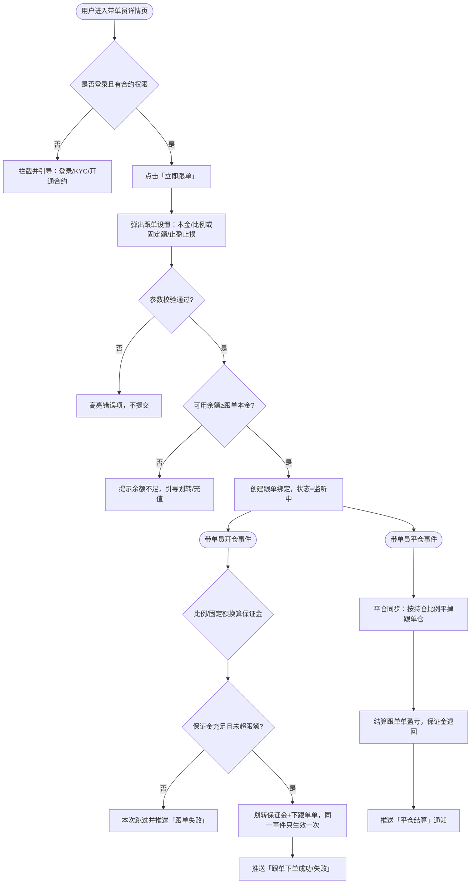

（文档标题：【合约】跟单交易 · 一键跟单下单 PRD）

> 本文件为 kit 参考范例（标准档，已过全部 18 条检查），非真实需求；编写记录字段仅为占位。US2-R2 的错误码表**形态**可直接照抄（一码一行、正文与验收只引场景/文案），但**码名是范例虚构**——真实 PRD 里码名由产品与研发敲定，没定就把码列留空待回填，别自己现编（`07 §二之三`）。

# 编写记录

| # | Version | Description 变更摘要 | Author | Commented | Confirmed | Date |
|---|---------|--------------------|--------|-----------|-----------|------|
| 1 | v1.0 | 初稿：带单员详情页一键跟单、跟单设置、开平仓同步下单、结算与推送通知 | @产品负责人 | N | N | 2026-07-05 |

---

# Background & Business Values 背景与价值

| 字段 | 内容 |
|------|------|
| 背景 | 合约业务中，有交易意愿但缺乏盘感的用户（看不懂 K 线、不会择时、没时间盯盘）目前只能自己手动开平仓，胜率低、亏损面大，是合约新客留存最差的一批人。带单员（KOL/职业交易员）已在平台产生真实交易，但用户无法低成本复制其操作，只能人工照抄，存在延迟大、易错单、无法自动平仓等问题。 |
| 价值 | 本次提供「一键跟单」能力：用户在带单员详情页一次性配置跟单本金与止盈止损后绑定带单员，此后带单员每次开/平仓，系统按用户设置的比例或固定额自动划转保证金并同步下单，无需人工盯盘。目标是把「看不懂盘」的合约用户转化为持续交易用户，提升合约新客的下单转化率与次月留存。 |
| BRD文档 | 无 |
| 需求来源 | @产品负责人 |
| 需求Jira单 | https://jira.mxcb.xyz/browse/APP-XXXXX（跟单主链路，待建单） |

## 目标用户

| 用户角色 | 关键特征 / 使用场景 | 规模 / 优先级 |
|---------|--------------------|--------------|
| 有交易意愿但看不懂盘的合约用户 | 已完成 KYC 并有合约交易权限，在带单员详情页浏览过带单员业绩，想复制其操作但不会/没时间手动跟；心智是「跟着高手赚，省心自动」 | 主要 |
| 已在手动照抄带单员操作的合约老用户 | 会看盘，但嫌手动跟单延迟大、漏平仓；希望用自动化替代人工照抄 | 主要 |
| 带单员本人（被跟单方） | 职业交易员/KOL，关注被跟单人数、跟单资金规模；本期只作为被跟单对象，不在本 PRD 交付带单员侧管理台 | 次要 |

---

## 成功指标

| 指标 | 基线值 | 目标值 | 统计口径（分母/周期/范围） | 类型 |
|------|--------|--------|--------------------------|------|
| 跟单转化率：进入带单员详情页 → 成功绑定跟单 | 待埋点建立基线 | ≥ 8% | 7 日滚动；分母 = 进入任一带单员详情页的去重用户数，分子 = 同周期内成功创建跟单绑定的去重用户数 | 主指标 |
| 跟单用户次月留存 | 待埋点建立基线 | ≥ 35% | 自然月；分母 = 上月成功创建过跟单绑定的用户数，分子 = 其中次月仍有跟单单成交的用户数 | 主指标 |
| 跟单单下单成功率 | 待埋点建立基线 | ≥ 97% | 7 日滚动；分母 = 系统尝试为跟单用户下的跟单单总数，分子 = 其中最终成交（含撤单前部分成交）的单数 | 护栏（涉资金/客诉风险需求可选加 1 条，默认不加；低于阈值说明同步链路不可靠，需先修复再推量） |

---

# 需求范围与边界 需求范围&风险点

## 本期包含

- 带单员详情页「立即跟单」入口与跟单设置弹窗（跟单本金、按比例/固定额、止盈止损）。
- 跟单绑定关系的创建、查看、解绑（关闭跟单）。
- 带单员开/平仓事件驱动的跟单同步下单：按用户设置划转保证金 + 下跟单单。
- 带单员平仓触发跟单用户结算，产出跟单单盈亏。
- 带单员卡片展示 30D 胜率、收益率、最大回撤三项业绩指标。
- 跟单下单成功/失败、平仓结算三类事件的 App/Web 站内推送通知。
- Web 与 App 双端实现。

## 本期不包含（Out of Scope）

- 不做带单员侧管理台（带单员设置分润比例、查看跟单人明细、主动踢除跟单人）。
- 不做跟单分润 / 收益分成结算给带单员（本期跟单用户盈亏全归用户自己，不向带单员分润）。
- 不支持按单个交易对/单个仓位单独配置跟单参数（一次绑定对该带单员的全部跟单单生效统一参数）。
- 不支持反向跟单、部分跟单（只跟开不跟平 / 只跟指定方向）。
- 不做跟单历史订单的独立报表页与导出（仅在现有合约订单列表内可见跟单标记）。
- 不做带单员业绩指标的实时逐秒刷新（30D 指标按 T+1 离线口径，详见 US2-R1）。

## 需求关联方与依赖

| 需求关联方 | 功能列表 | 产品对接人 | 技术对接人 |
|-----------|---------|-----------|-----------|
| APP 前端 | 详情页入口、跟单设置弹窗、跟单管理页、卡片业绩展示、推送落地 | @产品负责人 | @App-RD |
| Web 前端 | 同 App 的详情页/弹窗/管理页/卡片/站内信 | @产品负责人 | @Web-RD |
| 合约交易后端 | 跟单绑定服务、开平仓事件订阅、跟单下单、保证金划转、跟单结算 | @产品负责人 | @Trade-RD |
| 合约带单员统计服务 | 带单员 30D 胜率 / 收益率 / 最大回撤指标产出 | @产品负责人 | @Stat-RD |
| 资金/账户系统 | 现货/合约钱包保证金划转、可用余额查询、幂等入账/扣款 | @产品负责人 | @Fund-RD |
| 撮合引擎 | 跟单单实际下单撮合、成交回报 | @产品负责人 | @Match-RD |
| 消息推送平台（站内信/Push 网关） | 三类跟单事件通知的下发通道与去重能力 | @产品负责人 | @Push-RD |
| 风控系统 | 受限地区/账户风控/持仓限额校验 | @产品负责人 | @Risk-RD |

---

# Overall User Scenarios 用户场景总览

用户在带单员详情页发起跟单绑定；绑定成功后，跟单关系进入「监听中」状态。此后由带单员的开/平仓事件驱动系统自动为用户下跟单单，平仓时触发结算，并在关键节点推送通知。

---

# User Stories 用户故事

---

## US1：作为看不懂盘的合约用户，我希望在带单员详情页一键配置并绑定跟单，以便无需手动盯盘就能复制高手操作

### US1-R1：带单员详情页「立即跟单」入口与跟单设置弹窗

#### 线框原型图：
/

#### UED设计稿：
待补（Figma bookmark）

#### 需求逻辑：

#### 前端说明

带单员详情页底部提供「立即跟单」CTA；用户点击后弹出跟单设置弹窗，用户填写跟单本金、选择按比例或固定额、设置止盈止损，确认后创建对该带单员的跟单绑定关系。

**1. 「立即跟单」入口按钮**

| 原型 | 元素 | 说明 |
|------|------|------|
| 占位 | 立即跟单 CTA | **展示条件**：用户已登录、已完成 KYC、已开通合约交易，且该带单员当前为「可跟单」状态时，展示可点击的「立即跟单」。 **未满足时的分层处理**：① 未登录 → 按钮文案不变但点击拦截，唤起登录；② 已登录未 KYC/未开通合约 → 按钮置为「去开通」，点击跳转开通流程；③ 该带单员已停止带单或被风控下架（不可跟单）→ 按钮置灰不可点，副文案「该带单员暂不可跟单」；④ 当前用户对该带单员**已存在监听中的绑定** → 按钮文案变为「跟单设置」，点击进入 US1-R3 的管理态而非新建。 **交互**：满足展示条件时点击 → 弹出跟单设置弹窗（子模块 2）。 |

**2. 跟单设置弹窗**

| 原型 | 元素 | 说明 |
|------|------|------|
| 占位 | 跟单本金输入 | **展示规则**：币种固定为 USDT；输入框默认空，placeholder 展示最小跟单本金（取自配置）。金额精度 2 位小数，千分位分隔。 **校验（分输入域写清）**：输入=空 → 提交时高亮「请输入跟单本金」，不提交；输入=0 或低于最小跟单本金 → 提示「最低跟单本金为 X USDT」，不提交；输入 > 账户可用余额 → 提示「可用余额不足」并展示「去划转」，不提交；输入为非数字/负数/超过最大跟单本金等非法值 → 提示「请输入 X~Y 之间的金额」，不提交；输入合法 → 放行。 |
| 占位 | 跟单方式（按比例 / 固定额）单选 | **展示规则**：二选一单选，默认选中「按比例」。 **按比例**：用户填写跟单比例（如 10%），表示带单员每次开仓保证金 × 跟单比例作为本次跟单保证金；跟单比例取值域 (0%, 100%]，步长 1%，0%/空/>100% 均判非法并高亮不提交。 **固定额**：用户填写每次跟单的固定保证金（USDT），取值域 [单次跟单保证金下限, 单次跟单保证金上限]，越界高亮不提交。 **交互**：切换单选时，另一分支输入框置灰清空，仅提交当前选中分支的参数。 |
| 占位 | 止盈止损设置 | **展示规则**：止盈/止损各为一个开关 + 百分比输入，默认均关闭。开启止盈：填写止盈百分比（相对跟单单开仓价的浮盈比例），取值域 (0%, 500%]；开启止损：填写止损百分比，取值域 (0%, 100%]。 **校验**：开关开启但百分比为空/0/越界 → 高亮不提交；未开启则该项不参与下单，跟单单不挂止盈止损。 **交互**：止盈止损作用于「跟单单」自身，不改变带单员原单；触发止盈/止损平仓属于用户侧独立平仓，不等待带单员平仓。 |
| 占位 | 风险提示与确认 | **展示规则**：弹窗底部固定展示风险提示文案（合约有爆仓风险、跟单不保证盈利），用户需勾选「已阅读并同意《跟单服务协议》」后「确认跟单」按钮方可点击。 **交互**：点击「确认跟单」→ 先做前端校验（上述各项），全部通过 → 提交创建绑定（见 US1-R2）。 |

#### 后端说明：

**接口信息需求清单**（前端要哪些信息；字段命名与接口契约由技术方案定）

| 信息 | 说明 |
|------|------|
| 该带单员是否可跟单 | 合约带单员统计服务的带单员详情提供；带单员停止带单或被风控下架时为不可跟单，前端据此决定入口是可点还是置灰 |
| 跟单本金上下限 | 运营在配置中心维护（非行情数据），USDT 金额 2 位小数；用于输入框 placeholder 与「最低跟单本金为 X USDT」「请输入 X~Y 之间的金额」两处提示取值 |
| 单次跟单保证金上下限 | 运营在配置中心维护，USDT 金额 2 位小数；用于「固定额」分支的取值域校验 |
| 用户合约账户可用余额 | 资金/账户系统提供，实时查询，USDT 2 位小数；用于余额不足提示与「确认跟单」前的二次校验 |

#### 兜底逻辑：

| 异常场景 | 触发条件 | 系统行为 | 用户提示 |
|---------|---------|---------|---------|
| 详情页配置接口失败 | 带单员详情接口 5xx / 超时 | 停止 loading，「立即跟单」按钮置灰，展示页面级重试 | 「加载失败，请重试」，双端均提供重试按钮 |
| 可跟单状态缺失/非法 | 带单员详情接口有返回，但「是否可跟单」为空或不是有效的是/否取值 | 判为上游异常，按钮置灰（就低不就高，不误放跟单），记录日志告警 | 「该带单员暂不可跟单」 |
| 未登录 | 无有效登录态 | 拦截点击，唤起登录，登录后回跳详情页 | 标准登录弹窗 |
| 未 KYC / 未开通合约 | 登录但账户无合约交易权限 | 拦截，跳转开通引导 | 「需先完成实名并开通合约」 |
| 受限地区 | 风控返回该用户所在地区禁止合约/跟单 | 拦截，按钮置灰不可点 | 「您所在地区暂不支持跟单」 |
| 余额查询失败 | 可用余额查询超时/5xx | 弹窗仍可打开，但「确认跟单」前二次校验余额；查询失败时禁止提交并提示重试，不放行下单 | 「余额校验失败，请重试」 |

#### 验收：见文末 §验收标准

---

### US1-R2：创建跟单绑定关系

#### 需求逻辑：

#### 前端说明

用户在设置弹窗点击「确认跟单」后，系统创建当前用户与该带单员的跟单绑定关系，持久化跟单参数（本金、比例/固定额、止盈止损），并将关系状态置为「监听中」，作为后续开平仓同步下单的依据。

**1. 绑定创建规则**

| 原型 | 元素 | 说明 |
|------|------|------|
| 占位 | 绑定创建结果 | **展示规则**：创建成功 → 弹窗关闭，toast「跟单已开启」，详情页 CTA 变为「跟单设置」。 **唯一性规则**：同一用户 × 同一带单员在「监听中」状态下**至多一条**绑定关系；用户已存在监听中绑定时，创建请求返回「已在跟单」，前端提示并跳转跟单管理页，不新建第二条。 **幂等规则**：见后端逻辑。 **交互**：创建成功后新参数即刻对后续带单员开仓事件生效；对创建时点带单员**已持有的存量仓位**，本期规则为「不追单」（仅跟绑定之后的新开仓），此规则在弹窗内以副文案明示。 |

#### 后端说明：

**接口信息需求清单**（创建绑定要落哪些信息；字段命名与接口契约由技术方案定）

| 信息 | 说明 |
|------|------|
| 跟单绑定的唯一标识 | 创建成功后返回，前端后续用它定位这条绑定（跟单管理页展示、暂停、关闭都基于它） |
| 绑定归属 | 这条绑定属于哪个用户、跟的是哪位带单员 |
| 跟单方式与参数 | 按比例还是固定额，以及对应的跟单比例或固定保证金；用户设置后持久化，开仓同步照它换算 |
| 止盈止损设置 | 止盈、止损各自是否开启，开启时的百分比；未开启则该笔跟单单不挂止盈止损 |
| 跟单本金 | 用户本次设置的本金金额（USDT，2 位小数） |
| 绑定状态 | 监听中 / 已暂停 / 已关闭三者之一，由合约交易后端维护；跟单管理页据此展示状态标签、开平仓同步据此判断是否响应 |

> 资金幂等说明：创建绑定本身不发生资金划转（划转发生在开仓同步时，见 US1-R4）。为防「确认跟单」被重复点击或请求被重发造成重复绑定，**同一次提交只创建一条绑定**：重复提交返回的仍是已创建的那一条，不新建第二条、不重复占用资金。

#### 兜底逻辑：

| 异常场景 | 触发条件 | 系统行为 | 用户提示 |
|---------|---------|---------|---------|
| 创建绑定接口失败 | HTTP 5xx / 超时 | 弹窗保持打开，参数不丢失，允许重试；重试不会产生重复绑定 | 「开启跟单失败，请重试」 |
| 已存在监听中绑定 | 唯一性冲突 | 不新建，返回已有的那条绑定 | 「您已在跟单该带单员」并跳转管理页 |
| 提交后带单员转为不可跟单 | 创建瞬间该带单员变为不可跟单 | 拒绝创建，不落库 | 「该带单员已停止带单」 |
| 防重标识缺失 | 创建请求缺少可用于判定「是否同一次提交」的标识 | 拒绝该次请求且不落库（不静默补发），前端重新生成后重试 | 前端静默重试，用户无感 |

#### 验收：见文末 §验收标准

---

### US1-R3：跟单管理（查看 / 暂停 / 关闭跟单）

#### 需求逻辑：

#### 前端说明

用户可在跟单管理页查看已绑定的带单员及跟单参数，并可暂停或关闭跟单。关闭跟单后停止响应带单员新的开平仓事件。

**1. 跟单管理列表与操作**

| 原型 | 元素 | 说明 |
|------|------|------|
| 占位 | 跟单关系卡片 | **展示条件**：展示当前用户所有状态为「监听中」或「已暂停」的绑定；已关闭的不在列表展示。 **展示规则**：每张卡片展示带单员昵称/头像、跟单方式与参数、当前跟单持仓数与浮动盈亏（来源见后端逻辑）、状态标签（监听中/已暂停）。 **交互**： ① 暂停：监听中 → 已暂停，暂停期间**不响应带单员新开仓**，但**已持有的跟单仓位仍按原规则跟随带单员平仓**（即只停开、不停平），此规则在二次确认弹窗明示。 ② 关闭跟单：置为已关闭，二次确认。关闭时若用户仍持有跟单仓位，弹窗提供二选一：「立即市价平掉全部跟单仓」或「保留仓位仅解除绑定（后续该仓位不再自动平）」，用户显式选择，无默认项。 |

#### 后端说明：

**接口信息需求清单**（跟单管理页要哪些信息；字段命名与接口契约由技术方案定）

| 信息 | 说明 |
|------|------|
| 带单员昵称与头像 | 卡片展示用；头像缺失展示默认图 |
| 跟单方式与参数 | 卡片展示用，取 US1-R2 已持久化的绑定信息（按比例 / 固定额，及对应的比例或固定保证金） |
| 绑定状态 | 卡片状态标签用，只出现监听中 / 已暂停两种（已关闭的不在本列表展示） |
| 该绑定当前跟单持仓数 | 合约交易后端按绑定聚合，整数 |
| 该绑定跟单仓位浮动盈亏 | 合约交易后端按最新标记价计算（标记价取自行情/撮合服务）；USDT 2 位小数，带正负号并跟随站点涨跌色 |

> 资金幂等说明：关闭跟单触发的平仓与保证金退回，**重复点击或重试只生效一次**——跟单仓只被平一次、保证金只退一次。

#### 兜底逻辑：

| 异常场景 | 触发条件 | 系统行为 | 用户提示 |
|---------|---------|---------|---------|
| 管理列表接口失败 | HTTP 5xx / 超时 | 展示失败兜底 + 重试 | 「加载失败，请重试」（双端均有重试） |
| 无任何跟单绑定 | 列表返回空 | 展示空态（引导去发现带单员），不展示卡片 | 「你还没有跟单，去看看带单员」 |
| 跟单浮动盈亏缺失或非法 | 该绑定的浮动盈亏为空或为非法值 | 该字段展示占位「--」，不阻塞列表其余展示，记录日志 | 数值处显示「--」 |
| 关闭时平仓失败 | 市价平仓下单失败（撮合异常） | 不把绑定置为已关闭，回滚，允许重试；重试不会重复平仓 | 「平仓失败，绑定未关闭，请重试」 |
| 未登录/登录态失效 | 登录态失效 | 拦截并唤起登录 | 标准登录 |

#### 验收：见文末 §验收标准

---

### US1-R4：带单员开/平仓同步跟单下单（含保证金划转）

#### 需求逻辑：

#### 前端说明

系统订阅带单员的开/平仓事件。带单员开仓时，对每条监听中的绑定按用户设置的比例/固定额换算跟单保证金，划转保证金并下与带单员同方向的跟单单；带单员平仓时，按持仓比例平掉对应跟单仓。这是纯后端事件驱动逻辑，无前端交互，以下按系统行为描述。

**1. 开仓同步（系统行为）**

| 触发 | 系统行为 |
|------|---------|
| 收到带单员开仓事件（含交易对、方向、开仓保证金、杠杆、开仓价） | ① 查出该带单员所有状态为「监听中」的绑定（已暂停/已关闭跳过）。 ② 对每条绑定换算本次跟单保证金：按比例 → `跟单保证金 = 带单员开仓保证金 × 跟单比例`；固定额 → `跟单保证金 = 用户设置的固定保证金`。 ③ 校验：换算保证金 < 交易对最小下单额 → 本次**跳过**该绑定并推送「跟单失败-金额过小」；跟单账户可用余额 < 换算保证金 → 本次**跳过**并推送「跟单失败-余额不足，请补充保证金」；命中持仓限额/风控 → **跳过**并推送「跟单失败-超出限额」。 ④ 校验通过 → 划转保证金并下同方向单，**同一次开仓事件对同一条绑定只划转一次、只下一次单**；杠杆对齐带单员本次杠杆（超出用户合约档位上限则取上限并记录）。 ⑤ 下单结果推送「跟单下单成功/失败」（见 US2-R2）。 |

**2. 平仓同步（系统行为）**

| 触发 | 系统行为 |
|------|---------|
| 收到带单员平仓事件（全平或部分平，含平仓比例） | ① 找到该带单员该交易对下各绑定对应的跟单仓位。 ② 按带单员平仓比例同比例平掉跟单仓（带单员全平→跟单全平；平 50%→跟单平 50%）。 ③ 平仓成交后触发结算（见 US1-R5），退回可用保证金。 ④ **同一次平仓事件对同一条绑定只平一次**，重复投递的事件不重复平仓。 ⑤ 若跟单仓已被用户自身止盈止损/手动提前平掉 → 该绑定本次平仓事件视为**无仓可平**，静默跳过、不报错、不重复退款。 |

#### 后端说明：

**接口信息需求清单**（跟单同步要从带单员开/平仓事件拿到哪些信息；字段命名与接口契约由技术方案定）

| 信息 | 说明 |
|------|------|
| 带单员这次是开仓还是平仓 | 合约交易后端提供，跟单同步由它驱动；同一次开/平仓在系统内可被唯一识别，以保证「同一次事件对同一条绑定只处理一次」 |
| 带单员本次开仓保证金 | 「按比例」跟单时的换算基数，USDT 2 位小数 |
| 带单员本次杠杆 | 跟单单杠杆对齐它；超出用户合约档位上限则取上限 |
| 交易对 | 跟单单下在同一交易对上（如 BTCUSDT） |
| 开/平仓方向 | 看多 / 看跌；跟单单与带单员同方向 |
| 本次平仓比例 | 平仓事件提供，跟单仓按同比例平（全平/部分平） |
| 标记价 | 行情/撮合服务提供，用于跟单仓浮动盈亏与结算计算，2 位小数 |

> 资金幂等（US1-R4 重点）： 1. **划转保证金**与**下跟单单**统一按「同一次带单员事件 × 同一条绑定」判重，至多划转一次、下单一次。 2. 保证金划转与下单在同一事务/补偿链路内：若划转成功但下单失败，回滚（退回已划转保证金）并记账，避免资金被占用却无对应仓位。 3. 平仓退保证金同样只生效一次，重复投递的平仓事件不重复退款。

#### 兜底逻辑：

| 异常场景 | 触发条件 | 系统行为 | 用户提示 |
|---------|---------|---------|---------|
| 换算保证金过小 | 换算值 < 交易对最小下单额 | 跳过该绑定本次开仓，记录跳过原因 | 推送「跟单失败-金额过小」 |
| 余额不足 | 跟单账户可用 < 换算保证金 | 跳过该绑定本次开仓，不划转不下单 | 推送「跟单失败-余额不足，请补充保证金」 |
| 超持仓限额/风控拦截 | 命中限额或风控规则 | 跳过本次开仓 | 推送「跟单失败-超出限额」 |
| 划转成功但下单失败 | 撮合返回失败/超时 | 回滚已划转保证金（补偿），记账告警 | 推送「跟单失败-下单未成功，保证金已退回」 |
| 事件重复投递 | 同一次开/平仓事件被重复消费 | 判定为已处理，直接丢弃，不重复划转/下单/平仓 | 无（用户无感） |
| 事件关键信息缺失/非法 | 带单员开仓保证金、交易对或方向为空/非法 | 判为脏事件，不下单，进死信队列告警，人工核查 | 无（用户无感，避免错单） |
| 无仓可平 | 平仓事件时该绑定跟单仓已被用户提前平掉 | 静默跳过，不报错、不重复退款 | 无 |

#### 验收：见文末 §验收标准

---

### US1-R5：带单员平仓触发跟单结算

#### 需求逻辑：

#### 前端说明

带单员平仓且跟单仓平仓成交后，系统对该笔跟单单结算，计算已实现盈亏、退回保证金到用户合约可用余额，并触发结算通知。纯后端逻辑，按系统行为描述。

**1. 结算（系统行为）**

| 触发 | 系统行为 |
|------|---------|
| 跟单仓平仓成交回报到达 | ① 按成交均价计算本笔跟单单已实现盈亏：`已实现盈亏 = (平仓价 - 开仓价) × 数量 × 方向系数 - 手续费`。 ② 将（本金保证金 ± 盈亏 - 手续费）退回用户合约可用余额。 ③ 生成一条跟单结算记录（含带单员、交易对、方向、开平价、盈亏、手续费）。 ④ **同一笔平仓成交只入账一次**，已结算的重复回报直接丢弃。 ⑤ 结算完成推送「平仓结算」通知（见 US2-R2）。 |

#### 后端说明：

**接口信息需求清单**（结算要哪些信息；字段命名与接口契约由技术方案定）

| 信息 | 说明 |
|------|------|
| 本笔跟单单已实现盈亏 | 合约交易后端按成交均价与手续费计算（成交价来自撮合成交回报）；USDT 2 位小数，可为负，展示带正负号并跟随涨跌色 |
| 本笔手续费 | 撮合成交回报提供，USDT 2 位小数 |
| 退回可用余额的金额 | = 占用保证金 + 已实现盈亏（盈亏已扣手续费）；下限 0，穿仓走爆仓逻辑另计 |
| 结算记录内容 | 带单员、交易对、方向、开仓价与平仓价、盈亏、手续费——用户在结算记录里能看到这几项 |

> 资金幂等（US1-R5 重点）：**同一笔平仓成交只结算入账一次**——重复的成交回报、重复消费、入账超时后的重试，都只让用户可用余额增加一次，退回金额只到账一次。穿仓（退回金额算下来为负）不向用户可用余额扣负，转爆仓/风险准备金处理链路，不在本 PRD 展开。

#### 兜底逻辑：

| 异常场景 | 触发条件 | 系统行为 | 用户提示 |
|---------|---------|---------|---------|
| 结算入账重复 | 同一笔平仓成交的结算重复到达 | 判定为已入账，丢弃，不重复入账 | 无（用户无感） |
| 成交回报关键信息缺失/非法 | 成交价或手续费为空/非法 | 暂缓结算，转异常队列人工核对，金额留空待核对后入账 | 无（延迟到账，客服可查） |
| 退款到账失败 | 资金系统入账接口 5xx/超时 | 结算记录标记「入账待重试」，重试直到成功，且只入账一次 | 无（最终一致） |
| 穿仓 | 退回金额算下来为负 | 转爆仓处理，可用余额不扣负 | 结算记录标注「已爆仓」 |

#### 验收：见文末 §验收标准

---

## US2：作为跟单用户，我希望在带单员卡片看到可信业绩、并在跟单关键节点收到通知，以便决策跟谁跟以及知道我的跟单发生了什么

### US2-R1：带单员卡片业绩指标展示（30D 胜率 / 收益率 / 最大回撤）

#### 线框原型图：
/

#### UED设计稿：
待补

#### 需求逻辑：

#### 前端说明

带单员卡片（列表页与详情页头部）展示 30D 胜率、30D 收益率、30D 最大回撤三项，帮助用户横向比较带单员。

**1. 三项业绩指标**

| 原型 | 元素 | 说明 |
|------|------|------|
| 占位 | 30D 胜率 | **展示规则**：取值 0~100，展示为「整数或 1 位小数 + %」，中性色。 **分输入域**：取值=0 → 正常展示「0%」（表示近 30 日无盈利单，属真实数据，非异常）；未返回/为空 → 展示「--」（判为指标未产出/上游异常）；为负数/>100 等非法 → 展示「--」并记录日志。 |
| 占位 | 30D 收益率 | **展示规则**：百分比，2 位小数，涨绿跌红按站点色，带正负号（如 +12.34% / -5.00%）；超长值（如 +9999.99%）按千分位并在卡片内截断展示，点击详情看完整值。 **分输入域**：=0 → 展示「0.00%」中性色；未返回/为空 → 「--」；非法 → 「--」+日志。 |
| 占位 | 30D 最大回撤 | **展示规则**：百分比，2 位小数，固定以负向/红色语义展示（如 -23.45%），值域 [0,100]，越大代表回撤越深。 **分输入域**：=0 → 「0.00%」（近 30 日无回撤）；未返回/为空 → 「--」；非法 → 「--」+日志。 |

> 口径声明：三项指标均为 **30 日滚动、T+1 离线口径**（每日一次跑批产出，非实时逐秒），卡片旁标注「数据更新至 T-1」。本期不做实时刷新（见本期不包含）。

#### 后端说明：

**接口信息需求清单**（卡片要哪些信息；字段命名与接口契约由技术方案定）

| 信息 | 说明 |
|------|------|
| 30 日胜率 | 合约带单员统计服务 T+1 跑批产出，有效取值 0~100 |
| 30 日收益率 | 同上，百分比可为负 |
| 30 日最大回撤 | 同上，有效取值 0~100 |
| 指标数据截止时间 | 同上，用于卡片旁「数据更新至 T-1」标注 |

#### 兜底逻辑：

| 异常场景 | 触发条件 | 系统行为 | 用户提示 |
|---------|---------|---------|---------|
| 统计接口失败 | 带单员指标接口 5xx/超时 | 三项均展示「--」，卡片其余信息（昵称/头像/跟单按钮）正常，记录日志 | 数值处「--」 |
| 单指标缺失 | 某一项未返回或为空 | 仅该项「--」，其余两项正常展示 | 对应数值处「--」 |
| 指标值非法 | 负胜率/胜率>100/回撤>100 等 | 该项「--」并记录日志，不展示脏数据 | 「--」 |
| 空列表 | 带单员列表返回空 | 展示空态，不渲染卡片 | 「暂无带单员」 |

#### 验收：见文末 §验收标准

---

### US2-R2：跟单事件推送通知（下单成功/失败、平仓结算）

#### 需求逻辑：

#### 前端说明

在三类关键节点通过站内信 + Push 通知用户：① 跟单下单成功；② 跟单下单失败（含各失败情形）；③ 带单员平仓触发结算完成。纯后端触发 + 前端落地，按系统行为描述。

**1. 三类通知（系统行为）**

| 触发 | 系统行为 |
|------|---------|
| 跟单开仓下单成功（US1-R4 ④成功） | 发「跟单下单成功」通知：含带单员昵称、交易对、方向、跟单保证金、开仓价。落地跳转该跟单仓详情。 |
| 跟单开仓下单失败（US1-R4 各跳过/失败分支） | 发「跟单下单失败」通知：含带单员昵称、交易对，以及本次失败对应的文案（四种情形见子模块 2）。落地跳转跟单管理页。 |
| 平仓结算完成（US1-R5 ⑤） | 发「平仓结算」通知：含带单员昵称、交易对、已实现盈亏（带正负色）、退回金额。落地跳转结算记录。 |

**2. 错误码表：失败情形与用户看到的文案**（与 US1-R4 的跳过/失败分支一一对应；用户文案已同步进 §Localisation）

| 错误码 | 触发场景 | 用户文案与动作 |
|-------|---------|---------------|
| AMOUNT_TOO_SMALL | 换算出的跟单保证金低于交易对最小下单额 | 推送「跟单失败-金额过小」，本次不下单、不划转，点击落地跟单管理页 |
| INSUFFICIENT_BALANCE | 跟单账户可用余额不足以支付本次跟单保证金 | 推送「跟单失败-余额不足，请补充保证金」，本次不下单、不划转，点击落地跟单管理页 |
| EXCEED_LIMIT | 命中持仓限额或风控拦截 | 推送「跟单失败-超出限额」，本次不下单，点击落地跟单管理页 |
| ORDER_FAILED_REFUNDED | 保证金已划转但跟单单下单未成功 | 推送「跟单失败-下单未成功，保证金已退回」，保证金已回到可用余额，点击落地跟单管理页 |

**3. 推送冷却与去重（系统行为）**

| 规则 | 说明 |
|------|------|
| 去重 | 同一次跟单事件对同一条绑定的同一类通知**只推一条**，重复事件不重复推送（与下单/结算的「只生效一次」口径对齐）。 |
| 冷却/聚合 | 同一用户在活跃行情下可能因带单员高频开平仓收到大量通知。规则：**同一带单员 × 同一类通知，60 秒内多条合并为 1 条聚合推送**（如「BTCUSDT 等 3 笔跟单已下单」），聚合窗口内后续到达顺延累计；不同类通知（成功/失败/结算）不互相合并，各自独立冷却。 |
| 通道 | 站内信必达（可在消息中心回看）；Push 受系统通知开关控制，关闭时仅站内信，不重试 Push。 |

#### 后端说明：

**接口信息需求清单**（通知要哪些信息；字段命名与接口契约由技术方案定）

| 信息 | 说明 |
|------|------|
| 通知类型 | 「跟单下单成功」/「跟单下单失败」/「平仓结算」三者之一，决定通知文案模板与点击落地页 |
| 带单员昵称与交易对 | 三类通知正文都要展示 |
| 跟单保证金与开仓价 | 「跟单下单成功」通知正文展示 |
| 本次失败情形 | 「跟单下单失败」通知按情形取子模块 2 表里的对应文案 |
| 已实现盈亏与退回金额 | 「平仓结算」通知正文展示，盈亏带正负号与涨跌色（来自 US1-R5 结算结果） |

> 推送冷却（US2-R2 重点）： 1. **去重**：同一次跟单事件对同一条绑定的同一类通知只推一次。 2. **冷却聚合**：同带单员 × 同一类通知，60 秒滚动窗口内多条合并为 1 条聚合推送，避免高频行情下通知轰炸。 3. 三类通知独立冷却，互不合并（失败通知不能被成功通知冷却吞掉）。

#### 兜底逻辑：

| 异常场景 | 触发条件 | 系统行为 | 用户提示 |
|---------|---------|---------|---------|
| Push 通道失败 | Push 网关 5xx/超时 | 站内信仍写入（必达），Push 不无限重试（最多 1 次），记录失败 | 用户在消息中心可见站内信 |
| 用户关闭系统通知 | 系统级 Push 开关关闭 | 仅站内信，不下发 Push，不报错 | 站内信可回看 |
| 重复事件 | 同一次事件的同类通知重复触发 | 判定为已推送，不重复推送 | 无 |
| 高频轰炸 | 60s 内同带单员同类型多条 | 合并为 1 条聚合推送 | 聚合文案「等 N 笔」 |
| 通知内容缺失 | 昵称/金额等为空 | 缺失处以「--」占位，通知仍发出，不因单项缺失而不推 | 对应处「--」 |

#### 验收：见文末 §验收标准

---

# 验收标准

> 本章节按 US-R 一一对应汇总各功能点的验收断言（内容与原分散小节一致），另设「性能验收」收纳非功能需求相关断言。

## US1-R1 功能验收

- [ ] 当用户已登录、已开通合约、带单员处于可跟单状态时，详情页展示可点击「立即跟单」，点击 1 次在 1s 内弹出跟单设置弹窗。
- [ ] 当带单员为不可跟单，或「是否可跟单」为空 / 非法任一情况时，「立即跟单」均为不可点击态，且不会弹出跟单设置弹窗。
- [ ] 当跟单本金输入为空 / 0 / 低于最小跟单本金 / 超过最大跟单本金 / 超过可用余额 / 非数字时，分别展示对应错误文案且**不提交**创建绑定请求。
- [ ] 当选「按比例」且跟单比例 ∈ (0%,100%]、或选「固定额」且固定保证金 ∈ [单次跟单保证金下限, 上限] 时才允许提交；越界项高亮且不提交。
- [ ] 当未勾选跟单服务协议时，「确认跟单」按钮不可点击。
- [ ] 当详情页配置接口失败时，Web 与 App 均展示重试入口，且此时无法进入跟单设置。

## US1-R2 功能验收

- [ ] 当用户提交合法参数时，系统创建一条状态为「监听中」的绑定并返回该绑定标识，弹窗关闭并 toast「跟单已开启」。
- [ ] 当同一次「确认跟单」被重复提交（重复点击/网络重发）时，仅存在 1 条绑定关系，且返回的是同一条绑定，不重复占用资金。
- [ ] 当该用户对同一带单员已有监听中的绑定时，再次提交不新建第二条，提示「您已在跟单该带单员」。
- [ ] 当创建请求缺少防重标识时，该请求被后端拒绝且不落库。
- [ ] 当创建接口超时后用户重试时，不产生重复绑定。

## US1-R3 功能验收

- [ ] 当用户有监听中/已暂停的绑定时，管理页展示对应卡片，含带单员信息、参数、持仓数与浮动盈亏；已关闭的不展示。
- [ ] 当用户暂停某绑定时，该绑定状态变为「已暂停」，此后带单员新开仓不再产生该用户跟单单，但已有跟单仓仍随带单员平仓而平。
- [ ] 当用户关闭跟单且持有跟单仓时，必须显式二选一「立即平掉」或「保留仓位解绑」，无默认选项。
- [ ] 当关闭跟单的平仓请求重复触发（重复点击/重试）时，跟单仓只被平一次、保证金只退一次。
- [ ] 当跟单浮动盈亏缺失或非法时，仅该数值处显示「--」，卡片其余信息正常展示。

## US1-R4 功能验收

- [ ] 当带单员开仓且某绑定为「按比例」时，系统按「带单员开仓保证金 × 跟单比例」下同方向跟单单；为「固定额」时按用户设置的固定保证金下单。
- [ ] 当同一次开仓事件对同一条绑定被重复消费时，保证金只划转一次、跟单单只下一次。
- [ ] 当换算保证金 < 交易对最小下单额 / 余额不足 / 超限额时，系统跳过本次开仓且不划转资金，并分别推送对应失败文案。
- [ ] 当保证金划转成功但下单失败时，系统在同一补偿链路内退回已划转保证金，不留下无仓位的占用资金。
- [ ] 当带单员部分平仓（如 50%）时，对应跟单仓按同比例平仓；带单员全平时跟单全平。
- [ ] 当平仓事件到达但跟单仓已被用户提前平掉时，系统静默跳过且不重复退款。
- [ ] 当事件关键信息（交易对/方向/带单员开仓保证金）为空/非法时，系统不下单并将事件转入死信告警。

## US1-R5 功能验收

- [ ] 当跟单仓平仓成交时，系统按成交均价计算已实现盈亏并退回（保证金+盈亏-手续费）到用户合约可用余额。
- [ ] 当同一笔平仓成交的结算重复到达时，退回金额只入账一次。
- [ ] 当成交价或手续费为空/非法时，系统不入账、转异常队列，金额留空待人工核对。
- [ ] 当入账接口超时后重试时，用户可用余额只增加一次（无重复到账）。
- [ ] 当发生穿仓（退回金额算下来为负）时，用户可用余额不被扣为负数。

## US2-R1 功能验收

- [ ] 当三项指标均正常返回时，卡片展示 30D 胜率（含 0% 情形）、收益率（带正负号与站点涨跌色）、最大回撤，并标注「数据更新至 T-1」。
- [ ] 当某项指标为 0 时展示「0%/0.00%」而非「--」；当未返回/为空/非法时展示「--」。
- [ ] 当统计接口整体失败时，三项均「--」但卡片其余元素（含跟单按钮）仍可用。
- [ ] 当收益率为超长值时，卡片内千分位+截断展示，且可通过详情查看完整值。

## US2-R2 功能验收

- [ ] 当跟单开仓下单成功时，用户收到「跟单下单成功」通知（站内信必达，Push 视开关），点击落地跟单仓详情。
- [ ] 当开仓因金额过小/余额不足/超限额/下单失败退款而未成时，用户收到子模块 2 表中对应情形的失败文案。
- [ ] 当平仓结算完成时，用户收到含已实现盈亏与退回金额的「平仓结算」通知。
- [ ] 当同一次事件的同类通知重复触发时，用户只收到 1 条该通知。
- [ ] 当 60 秒内同一带单员同一类型产生多条通知时，合并为 1 条聚合推送；成功/失败/结算三类不互相合并。
- [ ] 当用户关闭系统 Push 时，仍能在消息中心回看对应站内信，且系统不报错。

## 性能验收

- [ ] 从带单员开/平仓事件落地到系统为跟单用户完成下单，P95 < 800ms（正常时段，不含撮合排队与网络 RTT）。
- [ ] 详情页/统计/管理列表核心读接口 P99 < 300ms（单节点，不含网络 RTT）。
- [ ] 跟单管理页首屏 FCP < 2s（P95）。
- [ ] 开/平仓事件端到端不丢不重（至少一次投递 + 幂等消费），重复率对用户资金影响为 0。

---

# 非功能需求 NFR

| 类型 | 要求 | 备注 |
|------|------|------|
| 同步下单时延 | 从带单员开/平仓事件落地到系统为跟单用户完成下单，P95 < 800ms（正常时段，不含撮合排队与网络 RTT） | 时延过大将放大跟单成交价与带单员的偏差 |
| 接口性能 | 详情页/统计/管理列表核心读接口 P99 < 300ms（单节点，不含网络 RTT） | |
| 页面性能 | 跟单管理页首屏 FCP < 2s（P95） | |
| 事件消费可靠性 | 开/平仓事件端到端不丢不重：至少一次投递 + 幂等消费，重复率对用户资金影响为 0 | 依赖「同一次事件对同一条绑定只处理一次」 |
| 客户端兼容 | iOS 14+ / Android 9+ | Web 支持主流 Chrome/Safari 最新两个大版本 |
| 安全/合规 | 受限地区拦截跟单；跟单服务协议留存用户同意记录；资金操作全链路可审计 | |

---

# Data Requirements 数据与埋点 **（情况A）需要埋点**

> 以下埋点 Web、App 均需实现（逐条已标端）。仅采集客户端可观测行为（曝光/点击/请求结果），服务端量（成交率、结算金额、留存）走服务端日志/数仓，不在此埋点。

| 截图 | 事件名(snake_case) | 触发时机 | 属性 | 属性中文 | 是否必传 | 端 | 属性说明 |
|------|-------------------|---------|------|---------|---------|----|---------|
| | `copytrade_lead_detail_exposure` | 带单员详情页曝光 | lead_id | 带单员ID | 是 | Web+App | 回收「详情页曝光→跟单」转化分母（对应主指标：跟单转化率） |
| | `copytrade_follow_cta_click` | 点击「立即跟单」CTA | lead_id / cta_state | 带单员ID / 按钮态(可点/去开通/置灰) | 是 | Web+App | 采集入口点击及不可点原因分布 |
| | `copytrade_setting_popup_exposure` | 跟单设置弹窗曝光 | lead_id | 带单员ID | 是 | Web+App | 漏斗中间步：CTA点击→弹窗曝光→确认 |
| | `copytrade_setting_confirm_click` | 点击「确认跟单」 | lead_id / copy_mode | 带单员ID / 跟单方式 | 是 | Web+App | 采集确认动作，配合返回结果算绑定成功率 |
| | `copytrade_bind_result` | 创建绑定请求返回 | lead_id / result / fail_code | 带单员ID / 成功失败 / 失败码 | 是 | Web+App | 前端可观测的绑定请求结果，回收转化率分子 |
| | `copytrade_manage_page_exposure` | 跟单管理页曝光 | - | - | 否 | Web+App | 留存观察：跟单用户是否回访管理页 |
| | `copytrade_notify_click` | 点击跟单通知（站内信/Push落地） | notify_type | 通知类型 | 是 | Web+App | 通知点击→回访转化，评估通知有效性与留存关系 |

---

# Localisation Requirements 本地化

| 原文（中文） | zh-CN | en-US |
|-------------|-------|-------|
| 立即跟单 | 立即跟单 | Copy Now |
| 跟单设置 | 跟单设置 | Copy Settings |
| 跟单已开启 | 跟单已开启 | Copy trading started |
| 跟单下单成功 | 跟单下单成功 | Copy order placed |
| 跟单下单失败 | 跟单下单失败 | Copy order failed |
| 跟单失败-金额过小 | 跟单失败-金额过小 | Copy failed – amount too small |
| 跟单失败-余额不足，请补充保证金 | 跟单失败-余额不足，请补充保证金 | Copy failed – insufficient balance, please add margin |
| 跟单失败-超出限额 | 跟单失败-超出限额 | Copy failed – position limit exceeded |
| 跟单失败-下单未成功，保证金已退回 | 跟单失败-下单未成功，保证金已退回 | Copy failed – order not placed, margin refunded |
| 平仓结算 | 平仓结算 | Position settled |
| 该带单员暂不可跟单 | 该带单员暂不可跟单 | This lead trader is currently unavailable |
| 数据更新至 T-1 | 数据更新至 T-1 | Data updated as of T-1 |

> 其余动态数值/带单员昵称等不做翻译。文案最终以本地化平台为准。

---

# 【待确认】

1. 跟单杠杆策略：跟单单杠杆完全对齐带单员本次杠杆，还是允许用户在设置中封顶（本 PRD 暂按「对齐带单员，超用户档位上限则取上限」，待与合约风控确认）。
2. 存量仓位是否支持「追单」：本期定为「只跟绑定后新开仓、不追存量仓」，待确认是否有强诉求需二期支持。
3. 穿仓/爆仓的用户侧展示与通知口径，是否需要独立通知类型（本期归入结算通知并标注「已爆仓」）。

---

# 风险与不确定性

| 风险 | 可能性 | 影响 | 缓解方案 |
|------|--------|------|---------|
| 高频行情下带单员短时间大量开平仓，跟单同步链路积压导致成交价严重偏离 | 中 | 高 | 同步链路限时时延护栏（NFR P95<800ms）+ 超时未成交则跳过并推送失败，不追价 |
| 资金划转与下单跨系统，异常时资金被占用无仓位 | 中 | 高 | 划转+下单同一补偿链路，失败回滚退保证金，全链路只生效一次 |
| 通知在高频场景轰炸用户 | 高 | 中 | 60s 同带单员同类型聚合 + 独立冷却 |
| 带单员业绩为 T+1 离线，用户误以为实时 | 中 | 中 | 卡片显式标注「数据更新至 T-1」 |
