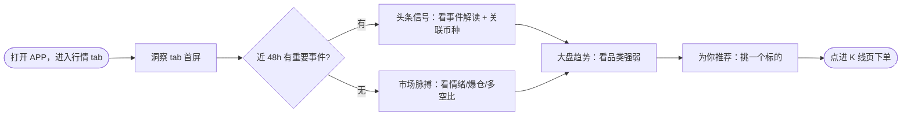

> **范例说明｜这是产品本人写的真实 PRD 改制**（有界面的标准档，形状与密度的权威样本）。**照搬形状与密度、别照搬业务名**——业务是行情洞察 tab，你的需求换成你自己的，形状一个字都别改。
> **要学的五件事**：① **一个板块一张元素表**，配一张该板块的**局部**截图 `rowspan` 覆盖全表（本篇四个板块＝四张表四张局部图；整页图只住「线框原型图」槽，两者不互相替代）；② **字段行自己讲清形态**——格式 ＋ 一个示例值 ＋ 兜底（「数值：整数，如 "72"」「缺失展示 "--"」）；③ **控件写信息结构**（半圆仪表盘＋中间数值、固定 3 格均分不可横滑、可见 2.5 张自动轮播 5 秒），不写色值尺寸；④ **「后端说明」按数据方分小节、每侧一张「模块｜说明」表**（后端目标 / 数据来源 / 筛选逻辑 / 数量规则 / 多语言 / 输出字段 / 数据流 / 刷新机制 / 返回顺序 / 兜底处理）；⑤ **「产品设计范式字典」与文末「PRD Quality Gates」11 问随文档保留**、按正文实际情况勾选（`06` 净化只删「Kit 自查清单」）。
> **章节层级照 house**：章 `#`、US `##`、US-R `###`、线框原型图 / UED设计稿 / 需求逻辑 / 前端说明 / 后端说明 / 兜底逻辑 `####`、板块小节 `#####`；文档标题走 `--title`，正文不写标题行。
> **原稿没有、kit 为门禁补的章**：目标用户 / 成功指标 / 本期不包含 / 模块地图 / 验收标准 / 异常与兜底——**写法从简**，够门禁即可，别把它们写成本篇的重头戏（成功指标尤其：1 行足矣）。

（文档标题：【AI】行情洞察tab「发现2.0」）

# 编写记录

| # | Version | Description 变更摘要 | Author | Commented | Confirmed | Date |
|---|---------|--------------------|--------|-----------|-----------|------|
| 1 | v1.0 | 初稿 | @产品负责人 | N | N | 2026-05-09 |

> 读者路由：研发→模块地图+功能需求；QA→验收标准；运营→产品设计范式字典

---

# Background & Business Values 背景与价值

| 字段 | 内容 |
|------|------|
| 背景 | 行情 tab 现状是「币对列表 + 豆腐块跳板块」的纯导航形态，用户进来只能「逛」，缺少「为什么现在交易这个币」的判断辅助。发现 tab 上线后从行为数据看，精选 tab 点击率 22.52% 远高于币种点击率 10.86%，说明用户存在被动接收「机会推荐」的强烈意愿，但当前模块承接不住——既没有事件驱动的解读，也没有个性化的币种推荐 |
| 价值 | 1. 把「逛行情」升级为「看洞察」——通过头条信号、市场脉搏、为你推荐三个模块，让用户每次进入 tab 都能看到「现在值得交易什么、为什么」，直接缩短从「打开 APP」到「下单」的决策路径<br>2. 把发现 tab 重命名为「洞察 tab」，从「广度（逛）」升级为「深度（懂）」，与首页豆腐块、币对列表形成差异化定位 |
| BRD文档 | （BRD 文档链接） |
| 需求来源 | 产品内部 |
| 需求Jira单 | APP-xxxxx（iOS）/ APP-xxxxx（Android） |

## 目标用户

| 用户角色 | 关键特征 / 使用场景 | 规模 / 优先级 |
|---------|--------------------|--------------|
| 有交易意愿、但没有明确标的的合约/现货用户 | 打开 APP 到行情 tab「看看有什么可做」，靠榜单和豆腐块自己找方向，缺少事件与情绪层面的判断依据 | 主要 |
| 只逛不下单的轻度用户 | 每天进 APP 看一眼行情就退出，对「涨了什么、为什么涨」有兴趣但不主动搜 | 次要 |

## 成功指标

| 指标 | 目标 | 统计口径（分母/周期） |
|------|------|--------------------|
| 洞察 tab 模块点击率 | 仅观察实际值，不设目标阈值 | 上线后 7 日；分母＝洞察 tab 曝光 UV，分子＝四个板块内任一可点区域的点击 UV，去重到人 |

$$洞察\ tab\ 模块点击率=\frac{洞察\ tab\ 内四板块点击\ UV}{洞察\ tab\ 曝光\ UV}$$

---

# 需求范围&风险点

## 本期包含

1. 发现 tab 更名为「洞察 tab」，整体框架与 tab 切换
2. 顶部卡：头条信号（事件快讯 + 关联币种）与市场脉搏（三指标）
3. 大盘趋势：1 张主卡片 + 最多 3 张次级卡片
4. 为你推荐瀑布流：币种卡片、0 费率卡片、资源位卡片混排
5. Futures/Spot 筛选器与设备维度的选择记忆
6. 各模块跳 K 线页 / 品类板块列表 / 活动落地页

## 本期不包含（Out of Scope）

- 不做瀑布流分页加载——本期一次性返回 100 张卡片、滚动到底即止
- 不改首页豆腐块——大盘趋势复用它的「品类列表 + 推荐币对列表」能力，豆腐块本身的展示与排序不动
- 不做洞察 tab 内的搜索与自定义订阅（推荐结果只由算法给，用户不可编辑）

## 需求关联方与依赖

<table>
<tr><th>需求关联方</th><th>功能列表</th><th>产品对接人</th><th>技术对接人</th></tr>
<tr><td>APP</td><td>
<ol>
<li>洞察 tab 整体框架与 tab 切换</li>
<li>顶部卡（市场脉搏 + 头条信号）轮播与交互</li>
<li>大盘趋势主卡片 + 次级卡片</li>
<li>为你推荐瀑布流（币种卡片、独立 0 费率卡片、资源位卡片混排）</li>
<li>Futures/Spot 筛选器与设备维度持久化记忆</li>
<li>各模块跳转 K 线、跳转板块列表、跳转活动落地页</li>
</ol>
</td><td>@产品对接人</td><td>@技术对接人</td></tr>
<tr><td>运营</td><td>
<ol>
<li>头条信号接口（透传大数据筛选后的事件 + 关联币种行情补全）</li>
<li>市场脉搏聚合接口（恐惧贪婪、24h 爆仓含环比、BTC 多空比，三指标统一返回）</li>
<li>大盘趋势接口（复用首页豆腐块的「品类列表 + 推荐币对列表」能力）</li>
<li>为你推荐聚合接口（协调大数据 / 算法 / 0Fee 三方数据，补全行情后回传 APP）</li>
</ol>
</td><td>@产品对接人</td><td>@技术对接人</td></tr>
<tr><td>大数据</td><td>
<ol>
<li>为你推荐瀑布流的整体千人千面排序；币种推荐能力上限由 50 个扩展到 100 个</li>
<li>0 费率卡片固定第 6 位、首个资源位固定第 3 位的硬性排序约束；资源位卡片占比约 20% 的混排算法（不连续分布、config 可配置）</li>
<li>头条信号筛选能力（近 48h AI 快讯按重要性 Top 5、按时间倒序、关联币种 1 对 1 输出，含多语言）；市场脉搏 2 指标（恐惧贪婪、24h 爆仓及环比）</li>
<li>币种卡片标签能力：FOMO 标签 + 第二信号槽位的 5 个事件标签计算；0Fee 卡片币对组装（合约侧「已交易 + 全部」去重）</li>
</ol>
</td><td>@产品对接人</td><td>@技术对接人</td></tr>
</table>

---

# Overall User Scenarios 用户场景总览

house 原稿这里用的是**内嵌 mindnote 脑图**；kit 路径下写一段 ```mermaid fence 即可——经 `lark-cli` 导入后自动转成原生可编辑画板，正文不残留代码（见 `06`）。



---

# 功能需求 User Stories 用户故事

## 模块地图

| 模块（US-R 编号 + 模块名） | 一句话干什么 | 本次（新增 / 修改 / 沿用） | 研发重点 | 测试重点 |
|---|---|---|---|---|
| US1-R1 洞察 tab | 一屏回答「现在值得交易什么、为什么」，含头条信号 / 市场脉搏 / 大盘趋势 / 为你推荐四个板块 | 新增 | 四个板块各自的数据源与刷新时机 | 板块缺失即隐藏、涨跌色、刷新不闪 |

> 【注】本篇只有 1 个 US-R，按 `02 §模块地图` 本可豁免；此处保留一行只作形状示意。

## US1: 作为用户，我希望进入行情洞察 tab 就看到现在值得交易什么、为什么

### US1-R1: 洞察 tab（头条信号 / 市场脉搏 / 大盘趋势 / 为你推荐）

> 本模块：把发现 tab 升级为洞察 tab，自上而下四个板块给出事件、情绪、品类、标的四层判断依据，任一板块无数据即整块隐藏、不占位。

#### 线框原型图：

〔洞察 tab 整页截图（可 1–3 张并排）〕

#### UED设计稿：

（Figma bookmark）

#### 需求逻辑：

**通用显示口径**（跨板块共享，各板块表内只写自己的差异项）：

- 涨跌幅：保留 2 位小数、带正负号，颜色跟随 APP 全局涨跌色
- 价格：精度跟随该币种价格精度
- 单字段缺失一律展示 `--`，不影响同卡其余字段

#### 前端说明

##### 头条信号

<table>
<tr><th>原型</th><th>元素</th><th>说明</th><th>后端说明</th></tr>
<tr><td rowspan="6">〔头条信号板块局部截图〕</td><td>头条信号模块</td><td>
<b>展示条件</b>
<ul><li>后端返回信号数据 ≥ 1 条时展示</li><li>后端返回 0 条或接口异常时，整个模块不展示（不占位）</li><li>所有用户（含未登录）均展示</li></ul>
<b>数量规则</b>
<ul><li>展示数量由后端控制，前端不做截断也不做补齐</li><li>后端返回几条就展示几条</li></ul>
<b>刷新机制</b>
<ul><li>进入洞察 tab 时请求一次并记录缓存（缓存仅当前生命周期有效，无需持久化），停留期间不刷新信号列表</li><li>有缓存优先展示缓存内容</li><li>用户手动刷新页面时请求并更新缓存</li><li>单条信号内的币种价格和涨跌幅跟随 APP 行情实时刷新范式，走势线不刷新</li></ul>
</td><td>透传大数据团队提供的数据</td></tr>
<tr><td>轮播交互</td><td>
<b>自动轮播</b>
<ul><li>多于 1 条信号时自动轮播，单条时不轮播</li><li>轮播间隔支持 config 文件配置，默认 5 秒</li><li>无限循环，到最后一条后回到第一条</li></ul>
<b>手动滑动</b>
<ul><li>用户可左右手动滑动切换</li><li>手动滑动后暂停自动轮播</li><li>暂停后不自动恢复，直到用户离开洞察 tab（切到其他行情 tab）再回来时重新触发自动轮播，从上次暂停的位置继续</li></ul>
</td><td>/</td></tr>
<tr><td>卡片整体</td><td>
<b>点击行为</b>
<ul><li>整个卡片区域可点击，跳转到关联币种的合约 K 线页（有合约优先合约）</li></ul>
</td><td>/</td></tr>
<tr><td>信号编号（右上）</td><td>
<b>展示规则</b>
<ul><li>位置在卡片右上角，格式：当前/总数，如 "1/4"</li><li>单条信号时不展示指示点</li><li>数值跟随轮播位置实时更新</li></ul>
</td><td>/</td></tr>
<tr><td>事件描述</td><td>
<b>展示规则</b>
<ul><li>后端返回的事件描述文案，最多展示 3 行</li><li>超过 3 行截断，末尾展示省略号</li></ul>
</td><td>后端返回描述文案</td></tr>
<tr><td>币种区</td><td>
<b>展示内容</b>
<ul><li>胶囊内展示：币种 icon + 币种简称 + 涨跌幅，如 "BTC +2.3%"</li><li>一条信号关联一个币种，后端 1 对 1 返回</li></ul>
<b>字段规则</b>
<ul><li>涨跌幅跟随 APP 行情实时刷新</li><li>颜色跟随涨跌色（与 APP 全局配色一致）</li></ul>
</td><td>后端返回关联币种的币种简称，前端走现有行情数据取涨跌幅</td></tr>
</table>

##### 市场脉搏

<table>
<tr><th>原型</th><th>元素</th><th>说明</th><th>后端说明</th></tr>
<tr><td rowspan="4">〔市场脉搏板块局部截图〕</td><td>市场脉搏模块</td><td>
<b>展示条件</b>
<ul><li>所有用户（含未登录）都展示</li><li>接口正常返回且至少有一个指标有数据时展示</li><li>整个接口异常或返回空时，整个模块不展示（不占位）</li></ul>
<b>展示规则</b>
<ul><li>固定 3 个指标横排展示：恐惧贪婪指数、24h 爆仓、BTC 多空比</li><li>不可横向滑动，固定 3 格均分</li><li>所有指标均不可点击，纯展示</li></ul>
<b>刷新机制</b>
<ul><li>进入洞察 tab 时请求一次</li><li>从其他 tab 切回洞察 tab 时重新请求</li><li>停留期间不自动刷新整个模块</li></ul>
</td><td>透传大数据团队提供的聚合数据</td></tr>
<tr><td>恐惧贪婪指数</td><td>
<b>展示内容</b>
<ul><li>标签：「市场情绪」</li><li>视觉形式：半圆仪表盘（弧形指针 + 彩色渐变底）+ 中间数值</li><li>数值：整数，如 "72"</li><li>仪表盘弧形底色按数值分段：恐惧区跌色、贪婪区涨色</li></ul>
<b>兜底</b>
<ul><li>后端返回该字段为空时，数值位展示 "--"，仪表盘按 UI 设计稿展示</li></ul>
</td><td>后端返回数值（0–100 整数），前端做颜色分段</td></tr>
<tr><td>24h 爆仓</td><td>
<b>展示内容</b>
<ul><li>标签：「24 小时爆仓」</li><li>主数值：爆仓金额，KMBT 缩写前加 "$" 符号，如 "$590 M"</li><li>副数值（主数值下方）：相对前一个 24h 的环比变化百分比，带正负号、保留 2 位小数，如 "+36.90%"</li></ul>
<b>字段规则</b>
<ul><li>主数值小数位保留 1 位，直接截断即可（不补 0，按 KMBT 缩写规则）</li><li>副数值颜色跟随涨跌色（正值涨色、负值跌色）</li></ul>
<b>兜底</b>
<ul><li>主数值为空：整个指标位展示 "--"</li><li>副数值为空：仅不展示副数值，主数值正常展示</li></ul>
</td><td>透传大数据返回：爆仓金额原值、环比变化百分比（口径由大数据侧统一）</td></tr>
<tr><td>BTC 多空比</td><td>
<b>展示内容</b>
<ul><li>标签：「BTC 多空比」</li><li>数值："XX / XX" 格式，如 "45 / 55"，左侧做多百分比、右侧做空百分比</li><li>精度：整数，前端控制，做多四舍五入，100 − 做多 = 做空</li></ul>
<b>颜色规则</b>
<ul><li>左侧做多数值跟随涨色，右侧做空数值跟随跌色</li></ul>
<b>兜底</b>
<ul><li>后端返回该字段为空时数值位展示 "--"，比例条不展示</li></ul>
</td><td>后端返回做多百分比和做空百分比两个字段</td></tr>
</table>

##### 大盘趋势

<table>
<tr><th>原型</th><th>元素</th><th>说明</th><th>后端说明</th></tr>
<tr><td rowspan="6">〔大盘趋势板块局部截图〕</td><td>大盘趋势模块</td><td>
<b>展示条件</b>
<ul><li>所有用户（含未登录）均展示</li><li>有效品类数 ≥ 4 时完整展示（1 主 + 3 次）</li><li>有效品类数等于 3 时展示 1 主 + 2 次</li><li>有效品类数小于 3 时仅展示主卡片</li><li>整个接口异常或返回空时，整个模块不展示</li></ul>
<b>有效品类定义</b>（复用豆腐块逻辑）
<ul><li>该品类下过滤用户 blacklist 的交易对、排除下线和隐藏的交易对后，剩余交易对数量 &gt; 0（黑名单取自合约黑名单接口，现有能力）</li><li>若品类为事件合约，需单独判断用户是否能交易事件合约</li></ul>
<b>数据来源</b>
<ul><li>复用首页豆腐块接口的「品类列表 + 推荐币对列表」结构</li><li>主卡片取品类下币对列表的前 4 个（第 1 个为主打，第 2–4 个为副币种）</li><li>次级卡片取该品类币对列表的第 1 个</li></ul>
<b>刷新机制</b>
<ul><li>进入洞察 tab 时请求一次并记录缓存（仅当前生命周期有效），停留期间不刷新</li><li>有缓存优先展示缓存内容；用户手动刷新页面时请求并更新缓存</li><li>币种价格和涨跌幅跟随 APP 行情实时刷新</li></ul>
</td><td>运营 BIZ 复用豆腐块接口能力（需前端研发确认是否满足）</td></tr>
<tr><td>模块标题</td><td>文案固定为「大盘趋势」（现有词条）</td><td>/</td></tr>
<tr><td>主卡片 - 头部</td><td>
<b>展示内容</b>
<ul><li>左上：品类名称（如 "Crypto"），展示后端返回的国际化文案</li><li>右上："&gt;" 箭头</li></ul>
<b>交互</b>
<ul><li>右上 "&gt;" 箭头点击：按后端返回的深链跳转该品类板块列表；深链为空时不展示箭头</li></ul>
<b>兜底</b>
<ul><li>品类名称缺失：整个主卡片不展示，模块整体也不展示（主卡片是必展示项）</li></ul>
</td><td>后端返回：品类名称（多语言）、跳转深链、该品类下的币对列表</td></tr>
<tr><td>主卡片 - 主打币种区（中部）</td><td>
<b>展示内容</b>
<ul><li>左：币种 icon + 币种简称（如 "BTC"）+ 最新价格</li><li>右：24h 走势线（1h 维度 24 个点，最后一个点为最新价，复用现有走势线组件，颜色跟随涨跌色，取值由前端做）</li><li>价格下方：涨跌幅（带正负号）</li></ul>
<b>字段规则</b>
<ul><li>价格精度跟随币种价格精度；涨跌幅保留 2 位小数</li><li>价格与涨跌幅颜色均跟随涨跌色</li></ul>
<b>交互</b>
<ul><li>该区域点击：跳转该币种的合约 K 线页，无合约时跳现货 K 线</li></ul>
<b>兜底</b>
<ul><li>价格 / 涨跌幅 / 走势线任一缺失：缺失的字段展示 "--" 或不展示走势线，其他正常展示</li></ul>
</td><td>主打币种取有效品类币对列表第 1 个</td></tr>
<tr><td>主卡片 - 副币种区（底部）</td><td>
<b>展示内容</b>
<ul><li>横排 3 个副币种，每个展示：币种简称 + 涨跌幅，如 "ETH -5.06%"</li><li>不展示 icon、不展示价格、不展示走势线</li></ul>
<b>字段规则</b>
<ul><li>涨跌幅保留 2 位小数、带正负号，跟随涨跌色</li></ul>
<b>交互</b>
<ul><li>单个副币种点击：跳转该币种的合约 K 线页，无合约时跳现货 K 线</li></ul>
<b>兜底</b>
<ul><li>单个副币种的涨跌幅缺失：该副币种位置展示 "--"</li><li>副币种整体缺失：该位置留空（需 UI 设计兜底）</li></ul>
</td><td>副币种取有效品类币对列表第 2–4 个</td></tr>
<tr><td>次级卡片（下方 3 个小卡片）</td><td>
<b>展示内容</b>（每个次级卡片）
<ul><li>左上：品类名称；右上："&gt;" 箭头</li><li>下方：1 个代表标的，展示 "{币种简称} {涨跌幅}%"，如 "NVDA +1.46%"、"GOLD +0.83%"</li></ul>
<b>字段规则</b>
<ul><li>涨跌幅精度、颜色规则同主卡片</li><li>不展示价格，只展示币种简称 + 涨跌幅</li></ul>
<b>交互</b>
<ul><li>卡片上方点击：按后端返回的深链跳转对应品类的板块列表；深链为空时不展示箭头</li><li>卡片下方标的区域点击：跳转该币种的合约 K 线页，无合约时跳现货 K 线</li></ul>
<b>数量规则</b>
<ul><li>有效品类数等于 4 时展示 3 个次级卡片</li><li>有效品类数等于 3 时展示 2 个次级卡片</li><li>有效品类数小于 3 时不展示次级卡片（仅展示主卡片）</li></ul>
<b>兜底</b>
<ul><li>品类名称缺失：该次级卡片不展示</li><li>代表标的缺失：币种区域兜底 "--"，整卡仍可点击跳板块列表</li></ul>
</td><td>后端返回：品类名称（多语言）、跳转深链、代表标的的币种简称</td></tr>
</table>

##### 为你推荐

<table>
<tr><th>原型</th><th>元素</th><th>说明</th><th>后端说明</th></tr>
<tr><td rowspan="6">〔为你推荐板块局部截图〕</td><td>为你推荐模块</td><td>
<b>展示条件</b>
<ul><li>所有用户（含未登录）均展示</li><li>大数据接口异常时，整个模块不展示</li><li>AI 算法异常时，运营 Base 降级返回纯币种列表，前端正常展示币种卡片</li></ul>
<b>整体布局</b>
<ul><li>瀑布流两列布局</li><li>卡片类型混排：币种卡片、0 费率卡片（唯一）、资源位卡片</li><li>一次性返回 100 张卡片，不做分页加载</li></ul>
<b>刷新机制</b>
<ul><li>进入洞察 tab 时请求一次</li><li>跟随洞察 tab 的下拉刷新，不单独支持瀑布流内部下拉刷新</li><li>从其他 tab 切回洞察 tab 时无需重新请求，且保持用户滚动位置</li><li>切换 Futures/Spot 筛选时重新请求整个列表</li><li>币种价格和涨跌幅跟随 APP 行情实时刷新</li></ul>
</td><td>运营 Base 提供聚合接口</td></tr>
<tr><td>模块标题</td><td>文案固定为「为你推荐」</td><td>/</td></tr>
<tr><td>Futures/Spot 筛选器</td><td>
<b>位置</b>
<ul><li>模块标题右侧</li></ul>
<b>展示内容</b>
<ul><li>默认选中「合约」，支持切换到「现货」</li></ul>
<b>交互</b>
<ul><li>点击筛选器弹出底部抽屉弹窗，用户在弹窗中选择合约或现货</li><li>切换后整个瀑布流重新请求（合约 / 现货推荐列表）</li><li>币种卡片点击跳转对应现货 / 合约的 K 线页（选合约优先跳合约 K 线，选现货优先跳现货 K 线）</li></ul>
<b>默认态</b>
<ul><li>进入洞察 tab 默认为合约，但需缓存记忆用户上次选择（设备维度 + 持久化）</li></ul>
</td><td>/</td></tr>
<tr><td>币种卡片</td><td>
<b>必展示字段</b>
<ul><li>币种 icon</li><li>币种名称（简称）</li><li>涨跌幅（带正负号，颜色跟随涨跌色）</li><li>24h 走势线（颜色跟随涨跌色，1h 维度共 24 个点，复用现有走势线组件）</li><li>多空比条：单方向展示，如「看多 58%」或「看空 58%」——Long 场景左侧长条为涨色，Short 场景左侧长条为跌色</li></ul>
<b>可选字段</b>
<ul><li>底部信号标签：最多 2 个，分 FOMO 标签与事件标签两类（事件标签定义见「后端说明 → 事件标签」）；无标签时该区域不展示</li><li>0 费率标签</li></ul>
<b>兜底</b>
<ul><li>走势线缺失：不展示走势线</li><li>信号标签缺失：不展示标签</li><li>多空比缺失：不展示整个多空比条</li><li>其他必展示字段缺失：该卡片不展示</li></ul>
<b>交互</b>
<ul><li>整卡点击：跳转对应币种的 K 线页<ul><li>合约筛选下：跳合约 K 线，无合约时跳现货</li><li>现货筛选下：跳现货 K 线，无现货时跳合约</li><li>未登录用户：跳转行为同已登录</li></ul></li></ul>
</td><td>后端返回：币种符号、走势线数据、多空比数值和方向、信号标签数组</td></tr>
<tr><td>0 费率卡片（仅合约 tab 有此卡片，后端控制）</td><td>
<b>唯一性</b>
<ul><li>整个瀑布流中仅 1 张 0 费率卡片</li><li>固定排在第 6 位（后端 AI 算法硬性约束）</li></ul>
<b>必展示字段</b>
<ul><li>标题「0 费率」（首页线上词条）</li><li>累计节省金额：实时数据，如 "$31,882.80"</li><li>副标题「累计节省」（首页线上词条）</li><li>币种 icon 组：展示 0 费率专区中的代表币种 icon，逻辑与首页小组件一致，仅展示前 5 个、无需轮播</li><li>CTA 按钮「查看」</li></ul>
<b>字段规则</b>
<ul><li>累计节省金额精度：保留 2 位小数、带千分位</li><li>币种 icon 展示数量以接口返回为准</li></ul>
<b>数据来源待确认</b>
<ul><li>累计节省金额与币种 icon 组的数据来源待评审时与研发确认</li><li>优先走运营 Base 聚合返回，若现状为独立接口则前端单独调用</li></ul>
<b>交互</b>
<ul><li>整卡可点击（含查看按钮和卡片其他区域），点击后打开 0 费率专区弹窗</li><li>0 费率专区弹窗为现有能力，直接复用</li></ul>
</td><td>透传大数据侧提供的 0 费率合约币对列表 + 0 费率合约交易对总数</td></tr>
<tr><td>资源位卡片</td><td>
<b>展示字段</b>（由后端返回）
<ul><li>主视觉图、主标题</li><li>CTA 按钮文案：后端未返回时前端兜底文案「查看」，按钮一定要展示</li><li>跳转链接（URL 或 schema）</li></ul>
<b>渲染方式</b>
<ul><li>前端按固定结构渲染（主视觉 + 标题 + 副标题 + CTA 按钮），非纯 banner 图</li><li>多语言文案由后端提供</li></ul>
<b>活动生命周期</b>
<ul><li>活动下线或过期由后端过滤，前端不做时间判断</li><li>前端拿到什么卡片就展示什么</li></ul>
<b>交互</b>
<ul><li>整卡可点击（含 CTA 按钮），按后端返回的链接跳转：URL 跳 H5 页面、schema 跳 APP 原生页面</li><li>未登录用户：跳转行为同已登录</li></ul>
</td><td>后端返回：主视觉 URL、主标题、CTA 文案、跳转链接</td></tr>
</table>

#### 后端说明

##### 市场脉搏（大数据+运营）

<table>
<tr><th>指标</th><th>说明</th></tr>
<tr><td>恐惧贪婪指数</td><td>
<ul><li>数据来源：Alternative.me Crypto Fear &amp; Greed Index 公开数据，源头每日更新一次（UTC 00:00）</li><li>后端缓存策略：缓存 5 分钟（源头虽日更，统一 5 分钟缓存降低复杂度）</li><li>需要返回的内容：指数数值（0–100 整数）</li><li>兜底：数据来源为空或缓存超过 48 小时，对应字段置空返回</li></ul>
</td></tr>
<tr><td>24h 爆仓</td><td>
<ul><li>数据来源：Coinglass 公开数据，全网合约爆仓汇总；免费接口有频率限制，后端定时拉取并缓存，每分钟拉取一次</li><li>后端缓存策略：缓存 1 分钟</li><li>需要返回的内容：24h 全网总爆仓金额（USD）、24h 爆仓环比变化百分比（精确到小数点后两位，由大数据侧计算、运营 BIZ 透传）</li><li>兜底：数据来源为空或缓存超过 10 分钟，对应字段置空返回</li></ul>
</td></tr>
<tr><td>BTC 多空比（APP 前端调用合约侧接口）</td><td>
<ul><li>数据来源：平台内部数据，BTC/USDT 永续合约的多空持仓人数比，跟随平台内部数据更新、实时可用</li><li>后端缓存策略：缓存 5 分钟</li><li>需要返回的内容：多仓持仓比例、空仓持仓比例</li><li>兜底：数据来源为空或缓存超过 12 小时，对应字段置空返回</li></ul>
</td></tr>
</table>

##### 头条信号

头条信号是洞察 tab 顶部卡片区域的事件快讯部分，展示全球重要事件 + 关联币种，引导用户点击进入 K 线交易。后端涉及两方：

- **大数据**：AI 快讯能力方，负责筛选和多语言
- **运营 BIZ**：服务端接入层，透传大数据的数据给 APP

**大数据侧（能力方）**

| 模块 | 说明 |
|------|------|
| 后端目标 | 从 AI 快讯中筛选最具交易价值的重要事件，输出给运营接入层 |
| 数据来源 | 复用现有 AI 快讯能力（大数据侧维护） |
| 筛选逻辑 | 近 48 小时内按「重要性」排序取 Top 5，这 Top 5 内部按时间倒序 |
| 数量规则 | 3–5 条，实时浮动；重要事件不多时可少于 5 条，不足 3 条时有几条返回几条 |
| 关联币种 | AI 快讯本身已带币种标签（现成能力）；一条快讯关联多个币种时由大数据侧取「最相关」的那一个返回。找不到合适关联币种的快讯在源头过滤掉，不输出 |
| 多语言 | 大数据侧已有多语言能力，按用户语言返回快讯正文 |
| 输出字段 | 快讯正文（多语言）、关联币种简称、快讯 ID |

**运营 BIZ 侧（接入层）**

<table>
<tr><th>模块</th><th>说明</th></tr>
<tr><td>后端目标</td><td>透传大数据的头条信号数据给 APP，补全关联币种的行情信息</td></tr>
<tr><td>能力定位</td><td>新建 APP 端接口，不复用现有快讯接口（UI 和数据结构已不同）</td></tr>
<tr><td>数据流</td><td>
<ol><li>APP 请求接口</li><li>BIZ 调用大数据能力获取筛选后的快讯列表</li><li>BIZ 按关联币种补全涨跌幅</li><li>返回给 APP</li></ol>
</td></tr>
<tr><td>补全内容</td><td>关联币种的涨跌幅</td></tr>
<tr><td>缓存策略</td><td>10 分钟缓存</td></tr>
<tr><td>刷新机制</td><td>
<ul><li>定时刷新：每 10 分钟主动拉取大数据更新缓存</li><li>事件触发：大数据侧有突发重大事件时主动通知 BIZ 失效缓存重新拉取，保证时效性</li></ul>
</td></tr>
<tr><td>返回顺序</td><td>按大数据返回顺序透传，即按时间倒序，前端按此顺序展示</td></tr>
<tr><td>兜底处理</td><td>
<ul><li>大数据异常或返回空：整个头条信号不展示</li><li>返回数量少于 3 条：按实际数量展示，不做补齐</li><li>单条快讯关联币种行情补全失败：该条快讯不展示，其余正常</li></ul>
</td></tr>
</table>

##### 为你推荐（大数据+AI算法+运营BIZ+运营Base）

为你推荐模块是洞察 tab 的瀑布流信息流。后端涉及 3 方协作：

- **运营 BIZ**：提供活动资源位卡片的物料
- **大数据 & 算法**：整合币种推荐、0Fee 卡片、活动卡片，做千人千面排序，输出最终卡片序列
- **运营 Base**：服务端接入层，协调各方数据，补全行情信息后回传 APP

**运营 BIZ 侧**

| 模块 | 说明 |
|------|------|
| 后端目标 | 提供活动资源位卡片的物料 |
| 能力定位 | 复用现有首页活动卡片，在洞察 tab「为你推荐」位置新增投放场景 |
| 透传字段 | 活动分类、业务线、业务价值、活动 ID、透传页面类型 |
| 活动生命周期 | 下线或过期活动由 BIZ 过滤，不透传给大数据 & 算法 |

**大数据 & 算法侧（核心整合方）**

<table>
<tr><th>模块</th><th>说明</th></tr>
<tr><td>后端目标</td><td>整合币种推荐、0Fee 卡片、活动卡片三类物料，做千人千面排序，输出最终瀑布流卡片序列</td></tr>
<tr><td>输入来源</td><td>
<ul><li>币种推荐：大数据自有推荐引擎产出</li><li>活动卡片：运营 BIZ 透传</li><li>0Fee 卡片：合约侧数据源（用户维度）提供「用户已交易过的 0 费率合约币对列表」「全部的 0 费率合约币对列表」及其总数；大数据侧输出 [已交易] + [全部] 去重后的列表 + 总数</li></ul>
</td></tr>
<tr><td>币种推荐能力扩展</td><td>当前推荐币种上限 50 个，本期需提升到 <b>100 个</b></td></tr>
<tr><td>排序规则（硬性约束）</td><td>
<ul><li>0Fee 卡片（全局唯一一张）固定排在<b>第 6 位</b></li><li>首个资源位卡片固定排在<b>第 3 位</b></li><li>其余资源位卡片在后续位置自由排布，不做位置约束</li></ul>
</td></tr>
<tr><td>资源位卡片比例控制</td><td>整个瀑布流中资源位卡片占比约 <b>20%</b>，剩余 80% 为币种卡片；比例支持 config 可配置；当前用户命中的资源位卡片不足 20% 时按实际数量插入，不补齐</td></tr>
<tr><td>资源位卡片分布</td><td>不连续出现（假设当前是 n，至少 n±3），需在币种卡片之间自然交错</td></tr>
<tr><td>千人千面逻辑</td><td>基于用户画像做活动匹配和币种个性化排序</td></tr>
<tr><td>输出内容</td><td>完整的瀑布流卡片序列，每张卡片带类型标识（币种卡 / 0Fee 卡 / 资源位卡）和对应字段</td></tr>
<tr><td>兜底处理</td><td>大数据 &amp; 算法整体异常时返回空数据，前端收到空数据后整个「为你推荐」模块不展示</td></tr>
</table>

**运营 Base 侧（服务端接入层）**

<table>
<tr><th>模块</th><th>说明</th></tr>
<tr><td>后端目标</td><td>APP 请求的统一入口，协调各方数据，补全卡片展示所需的行情信息后回传 APP</td></tr>
<tr><td>请求流转</td><td>
<ol><li>APP 打开行情页，请求携带页面类型</li><li>Base 查询用户命中的活动卡片</li><li>Base 将活动分类、业务线、业务价值、活动 ID、透传页面类型传给大数据 &amp; 算法</li><li>大数据 &amp; 算法过滤排序活动卡片，整合币种卡片和 0Fee 卡片，做整体排序后返回</li><li>Base 根据返回的卡片序列，补全 K 线、涨跌幅等行情信息</li><li>Base 返回完整卡片流给 APP</li></ol>
</td></tr>
<tr><td>补全内容</td><td>K 线数据、最新价格、涨跌幅等行情维度数据</td></tr>
<tr><td>兜底处理</td><td>
<ul><li>大数据 &amp; 算法返回空：整个模块不展示</li><li>单张卡片信息补全失败：该卡片不展示，不影响其他卡片</li></ul>
</td></tr>
</table>

**整体排序示例**

大数据 & 算法整合后的卡片序列（100 个币种 + 1 个 0Fee + 若干资源位卡片）：

| 位置 | 卡片类型 | 备注 |
|---|---|---|
| 1 | 币种卡片 | -- |
| 2 | 币种卡片 | -- |
| 3 | 首个资源位卡片 | 硬性位置约束 |
| 4 | 币种卡片 | -- |
| 5 | 币种卡片 | -- |
| 6 | 0Fee 卡片 | 硬性位置约束，全局唯一 |
| 7 | 币种卡片 | -- |
| ... | ... | 后续资源位卡片按 20% 比例自由插入 |

**AI 算法可配置项**

| 配置项 | 默认值 |
|---|---|
| 资源位卡片整体占比 | 20% |
| 0 费率卡片固定位置 | 第 6 位 |
| 首个资源位卡片固定位置 | 第 3 位 |

###### 事件标签

对事件标签进行优化，重新定义 5 个事件标签（更新频率：1 小时）。下表只留表头 + 2 行示意，其余 3 个标签同形态：

| 标签名称 | type | 分类 | 现货/合约 | 文案模版 | 触发条件 | 输出参数 |
|---|---|---|---|---|---|---|
| 突破新高 | PRICE_BREAK_HIGH | 看多 | 现货+合约 | 「突破 {数量} 日新高」 | 突破幅度 =（当前价 − 前 N 日最高价）/ 前 N 日最高价 ≥ 0.5%。窗口匹配：先试 N = 7 日，未命中再试 N = 3 日，命中即输出，3 日和 7 日不同时输出 | 实际命中的窗口天数，3 或 7 |
| 跑赢 BTC | OUTPERFORM_BTC | 看多 | 现货+合约 | 「24h 跑赢 BTC +{百分比}%」 | 24h 相对涨幅 = 该币 24h 涨跌幅 − BTC 24h 涨跌幅 ≥ 5%，且该币 24h 涨幅 > 0（避免「BTC 大跌时该币只是少跌」也被算成跑赢） | 相对涨幅百分比，保留 1 位小数 |

###### 事件标签选取逻辑

**Step 1：方向匹配**

只保留与卡片多空比方向一致的标签：卡片显示 Bullish ≥ 50% 时仅保留看多方向的标签；卡片显示 Bearish > 50% 时仅保留看空方向的标签。

**Step 2：固定优先级**

按以下顺序看哪一类有候选，命中即停：

1. 价格行为（突破新高 / 跌破新低）
2. 衍生品异动（持仓量异动 / 资金费率异动）
3. 跨市场对比（跑赢 BTC）

价格行为最容易被普通用户看懂，所以排第一；衍生品次之；跨市场对比最弱（用户感知「跑赢 BTC」不如「突破前高」直观），排最后。

**Step 3：同类内有多个时按异动幅度选大的**

比如衍生品异动的两个标签同时满足，就选百分比绝对值更大的那个。

**Step 4：兜底**

5 个标签都不命中：事件标签由 AI 侧兜底生成；若兜底失败则返回空，前端不展示第二槽位，**不强行补齐**。

#### 兜底逻辑：

（house 原稿此处「不涉及，省略」——各板块的兜底已写在元素表；kit 为门禁 `exception_coverage` 补下面这张异常与兜底表，只放元素表没覆盖、且含真实决策的行）


| 异常场景 | 触发条件 | 系统行为 | 用户提示 |
|---|---|---|---|
| 板块接口异常或返回空 | 头条信号 / 市场脉搏 / 大盘趋势 / 为你推荐 任一接口 5xx、超时或返回 0 条 | 该板块整块不展示、不占位，其余板块照常渲染 | 无提示，静默降级 |
| 单条数据补全失败 | 头条信号关联币种行情补全失败；推荐流单张卡片行情补全失败 | 该条信号 / 该张卡片不展示，同列表其余项正常 | 无提示 |
| 单字段缺失 | 恐惧贪婪指数、BTC 多空比、副币种涨跌幅等单字段为空 | 该字段位展示 "--"，同卡其余字段照常展示 | 无提示 |
| 断网 / 弱网 | 无网络连接或请求超时 | 洞察 tab 走 APP 全局断网态，支持下拉重试 | 按产品设计范式字典的断网态文案 |

## 产品设计范式字典

（产品可直接引用，注明使用字典中第几条第几点）

<cite doc-id="basusJj0Nn5Rz68ftMgx9YRVJCb" file-type="bitable" table-id="tblntuACeDhenzKT" title="APP产品设计范式" type="doc" view-id="vewEOZHUHL"></cite>

---

# 验收标准

## US1-R1 功能验收

- [ ] 未登录进入洞察 tab：四个板块均可见（有数据的前提下），无任何登录拦截弹窗
- [ ] 头条信号返回 4 条：卡片右上角显示 "1/4"，静置 5 秒后自动切到第 2 条；手动左右滑动后自动轮播停止，切到其他行情 tab 再切回时从暂停位置继续轮播
- [ ] 头条信号返回 0 条或接口报错：整块不出现，且下方市场脉搏不留空白位
- [ ] 市场脉搏三指标：恐惧贪婪显示半圆仪表盘 + 整数（如 "72"）；把恐惧贪婪字段置空，数值位变 "--" 而仪表盘仍在，另外两个指标不受影响
- [ ] 大盘趋势按有效品类数取三种形态：≥4 个 → 1 主 + 3 次；=3 个 → 1 主 + 2 次；<3 个 → 只有主卡片；主卡片品类名缺失时整个模块消失
- [ ] 为你推荐首屏加载完成后，第 3 位是资源位卡片、第 6 位是 0 费率卡片，且全列表只有 1 张 0 费率卡片；滚动到第 100 张后不再加载
- [ ] 切 Futures/Spot：切到现货后瀑布流整列表重新拉取；杀进程重进 APP，筛选器仍停在上次选择的那一档
- [ ] 断网状态下进入洞察 tab：展示全局断网态并可下拉重试；恢复网络后重试一次即可正常渲染

---

# Data Requirements 数据与埋点

house 惯例是把埋点表另建 sheet 嵌入本章；下表为 kit 十列形态示意（完整规则见 `09 §5`）。

| 触发时机 | 事件名称英文 | 事件名称(中文) | 事件说明 | 事件属性英文 | 事件属性说明(cname) | 是否必传 | 属性值/取值 | 页面截图 | 备注 |
|---|---|---|---|---|---|---|---|---|---|
| 头条信号卡片曝光 | `standard_ElementExposure` | 元素曝光 | 回收头条信号曝光→点击转化 | module | 模块名称 | 是 | 由数分定值 | 见设计稿 | 每条信号曝光上报一次 |
| 头条信号卡片点击 | `standard_ElementClick` | 元素点击 | 回收头条信号引流效果 | button_name | 按钮名称 | 是 | 卡片点击 | 见设计稿 | 同事件另带 jira_id、link_url |
| 市场脉搏模块曝光 | `standard_ElementExposure` | 元素曝光 | 回收市场脉搏可见率 | jira_id | jira 卡号 | 是 | APP-xxxxx | 见设计稿 | 模块级曝光，不拆到单指标 |

---

# Localisation Requirements 本地化

| 原文（中文） | zh-CN | en-US |
|-------------|-------|-------|
| 市场情绪 | 市场情绪 | Market Sentiment |
| 24 小时爆仓 | 24 小时爆仓 | 24h Liquidation |
| BTC 多空比 | BTC 多空比 | BTC Long/Short Ratio |
| 大盘趋势 | 大盘趋势 | Market Trends |
| 为你推荐 | 为你推荐 | For You |

---

# PRD Quality Gates (Delete after finalised)

（house 惯例：随文档保留、按正文实际情况勾选；勾 No 的在交付时提醒产品）

1. 隐私/法律法规/安全是否进行了考虑
   - [ ] Yes
   - [ ] No
   - [ ] N/A
2. 超长问题是否进行了考虑？
   - [ ] Yes
   - [ ] No
   - [ ] N/A
3. 是否考虑到了登录态？
   - [ ] Yes
   - [ ] No
   - [ ] N/A
4. 是否考虑到弱网或者断网的用户体验？
   - [ ] Yes
   - [ ] No
   - [ ] N/A
5. 是否考虑了双端统一？
   - [ ] Yes
   - [ ] No
   - [ ] N/A
6. 是否考虑到了特殊App手势的处理？
   - [ ] Yes
   - [ ] No
   - [ ] N/A
7. 是否考虑到了接口的异步交互？
   - [ ] Yes
   - [ ] No
   - [ ] N/A
8. 是否需要风控介入？
   - [ ] Yes
   - [ ] No
   - [ ] N/A
9. 是否登记了翻译/校对任务 @ https://l7jipx1bfq.larksuite.com/share/base/form/shrusgtZjx5c1kwN0rGMeBcB8ne
   - [ ] Yes
   - [ ] No
   - [ ] N/A
10. FYI：校对前置任务填写手册：<cite doc-id="doxusT0tpnk9rphvWCU28jhciUh" file-type="docx" title="需求侧前置任务-英文翻译与校对流程" type="doc"></cite> https://l7jipx1bfq.larksuite.com/share/base/form/shrusjT9vJnjB1TdDPVwa6u7yNc
    - [ ] Yes
    - [ ] No
    - [ ] N/A
11. FYI：设计团队接口人：<cite doc-id="wikuslg1LESqG8S3U3i9lwmMSAe" file-type="wiki" title="产品设计部 - UI/UX 需求提交指南" type="doc"></cite>
    - [ ] Yes
    - [ ] No
    - [ ] N/A
